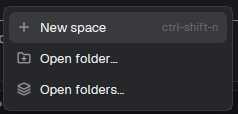

# Space Menu

A right-click menu for the Spaces list. On top of Herdr's own space items it offers New space, Open folder… (pick a folder, a space starts there) and Open folders… (pick several folders, get one space with a tab per folder). It appears where the person right-clicks, in place of the shipped space menu.



## What you see

**The menu**: a popup at the pointer, 230px wide, on `popover`, 5px padding, text 12.8px in `foreground`. Rows are 31px high, 8px side padding, radius 7, a 14px `muted` icon, 9px gap, the label, and at the right the bound key in 11px `dim` when the row's command has a `global` binding. The highlighted row is `selected`; hovered rows are `hover`. Rows, top to bottom:

1. New space (plus icon, key hint for `space.new`)
2. Open folder… (folder-plus icon)
3. Open folders… (layers icon)

When opened for a space (`props.space`), after a 1px `border` divider (7px side margin, 4px above and below): Rename (square-pen icon, key hint for `space.rename`); when the space's folder is a Git checkout, New worktree and Open worktree (git-branch icon); when it is a linked worktree, also Remove worktree; then after another divider, Close (x icon).

**The Open folder dialog**: 340×132px on `popover`, 18px padding. A folder-plus icon, the title "Open folder" at 15px semibold, `Esc` in 11px `dim` at the right; one `muted` sentence, "Choose a folder in the window that just opened. A new space starts there."; a Cancel button bottom right (30px high, radius 8, `raised` with an `input` border).

**The Open folders dialog**: 460×440px on `popover`, 18px padding. A layers icon, the title "Open folders" at 15px semibold, `Esc` at the right; a `muted` line, "One space with a tab for each folder."; an 11.5px `dim` label `Folders (N)`; a scrolling list that takes the remaining height (`background`, 1px `border`, radius 8, 4px padding) with one 30px row per folder: a 14px folder icon, the folder's name (at most 160px), its path in 11px `dim` with the home folder shortened to `~`, and a 12px × that removes it. Empty, the list reads "No folders yet." or, while the picker is open, "Choose a folder in the window that just opened.". Below: an "Add folder…" button (28px, `input` border, folder-plus icon; "Choosing…" and dim while the picker is open); the label "Space name (optional)" and a 34px input; when Claude Code is installed, a 15px checkbox (filled `accent` with a check when on) labelled "Start Claude Code with access to all of them"; an error line in `ansi1` if the picker fails; and at the bottom right Cancel and a `solid` "Create space" button, 45% opacity and inert until there is at least one folder, reading "Creating…" while it works.

## How it behaves

- Agent statuses (working, blocked, done, idle) are not shown: this is a menu. Nothing animates.
- Up/down move the highlight, Enter runs the row, Esc closes. A click runs the row. The popup closes first, then the row acts.
- **New space** runs `space.new` with no arguments.
- **Open folder…** opens the Open folder dialog, which immediately opens the system folder picker. A chosen folder runs `space.new {folder}` with no name, so Herdr names the space after the folder or its repository. Cancelling the picker, Esc or Cancel makes nothing. The dialog closes when the picker returns.
- **Open folders…** opens the Open folders dialog, which immediately opens the picker for the first folder. Each "Add folder…" opens it again. A folder already in the list (compared without trailing slashes, ignoring case) is not added twice. × removes a folder.
- **Create space** runs `space.new` in the first folder, named with the typed name, else the folder names joined with ` + ` when there are several, else unnamed. It then waits for the new space to appear (checking every 100 ms, up to 5 s), names its first tab after the first folder, runs `tab.new {space, folder, name}` for each other folder with the folder's name as the tab's name, selects the first tab again, and closes. If the space never appears, an error toast says the other folders weren't added.
- With the checkbox on, the first tab's `space.new` carries `argv`: Claude Code's launch command from `knownAgents()` followed by `--add-dir <folder>` for every folder after the first. The other tabs are plain terminals.
- Rename, the worktree items and Close do what Herdr's shipped space menu does: `space.rename {id}`, the shipped `worktree` dialog with `{space, action}`, `space.close {id}`.

## Built from

- `mods/space-menu/`: `main.js` and `mod.json` `{ "place": "none", "overlay": { "kind": "popup", "width": 230, "height": 320 } }`. Nothing docks by itself.
- `main.js`: one `View` with three roles by `props().role`: none, the menu (`props.space`: the right-clicked space's id, or absent off a row); `"pick"`, the Open folder dialog; `"multi"`, the Open folders dialog (`props.quiet: true` opens it without going straight to the picker).
- Opened by the sidebar mod, not by this one: `openOverlay({ mod: "space-menu", kind: "popup", at: "pointer", width: 230, height: 320, props: { space } })`. The menu opens its own dialogs: `openOverlay({ mod: "space-menu", kind: "dialog", width: 340, height: 132, props: { role: "pick" } })` and `{ width: 460, height: 440, props: { role: "multi" } }`.
- `herdr` functions: `run`, `props`, `openOverlay`, `closeOverlay`, `theme`, `keys`, `spaces`, `panes`, `exec`, `pickFolder`, `notify`, `knownAgents`, `home`. `gpui-base`: `v_flex`, `h_flex`, `InputState`, `Input`.
- Commands: `space.new`, `space.rename`, `space.close`, `tab.new`, `tab.rename`, `tab.select`. Programs: `git rev-parse --show-toplevel` and `git rev-parse --path-format=absolute --git-common-dir` in the space's folder on its machine, to tell a main checkout from a linked worktree.
- Shipped mods it uses: `worktree` (its dialogs, 560×480 for open and 440×260 otherwise) and icons from `mods/workspace-chrome/`: `plus`, `folder-plus`, `folder`, `layers`, `square-pen`, `git-branch`, `x`, `check`.

**Wiring it to the sidebar.** The Spaces sidebar mod decides what a right-click opens. Shipped mods and layouts are read-only and restored on every start: if the person's layout or sidebar mod is shipped, clone it (`mod.clone`, `layout.clone`), point the clone layout's spaces block at the cloned mod, and edit the clone. If the person already has their own layout, ask whether to change it or make a new one.

- Herdr's stock `spaces` mod (0.1.15) has one method to replace:

  ```js
  menu(w) {
    openOverlay({ mod: "menu", kind: "popup", width: 200, height: 260, props: { tab: "space", target: { id: w.id } } });
  }
  ```

  with

  ```js
  menu(w) {
    openOverlay({ mod: "space-menu", kind: "popup", at: "pointer", width: 230, height: 320, props: w ? { space: w.id } : {} });
  }
  ```

- Better Sidebar (3.3.0): the same replacement in `views/spaces.js`.
- In either, for the menu to open off a row too: make the row's right-press stop propagation (`.on_mouse_down("right", (_e, cx) => { cx.stop_propagation(); this.menu(w); })`) and add `.on_mouse_down("right", () => this.menu(null))` to the scrolling list element that holds the rows.
- No sidebar change at all: bind a key to `mod.open:space-menu`. Ask before taking a key the person already uses.

## Watch out

- Copying the folder alone shows nothing. The install is not done until a right-click in the person's Spaces list opens this menu, or they chose the key instead.
- A popup's tasks end when it closes, so the popup cannot wait for the folder picker itself. The picker is awaited by a dialog that stays open until it returns.
- `run()` returns nothing to a mod, so the new space's id is not available from `space.new`. Create space snapshots the space ids first and takes the id that appears. A space made by something else in that same moment would be mistaken for it.
- The Open folders dialog must stay open until the tabs are added: a closed overlay's timers stop.
- `.when(cond, …)` needs a real boolean.
- A space is not a sandbox. Do not describe Open folders… as restricting access: terminals can go anywhere, and `--add-dir` only tells Claude Code which folders to work in.
- `pickFolder` works on this computer only and returns one folder per call.
- The Claude Code option depends on a `knownAgents()` entry whose `key` is `claude` and that is `installed`.
- `herdr-app check` loads the mod with no props, so it exercises the menu only. To see the Open folders dialog without the picker: `herdr-app do pane.split '{"direction":"right","mod":"space-menu","props":{"role":"multi","quiet":true}}'`.
- Built and used on Windows with Herdr 0.1.15. Untested on macOS and Linux.

## Done when

- `herdr-app check` passes for `mods/space-menu` and for the sidebar mod that was edited; `herdr-app status` shows no errors.
- Right-clicking a space's row opens the menu with New space, Open folder…, Open folders…, Rename and Close; in a Git checkout it also has New worktree and Open worktree.
- Right-clicking the empty part of the Spaces list opens the menu with only the first three rows, once.
- Open folder… then choosing a folder makes a space whose first terminal is in that folder; cancelling the picker makes nothing and closes the dialog.
- Open folders… with two folders and no name makes one space named `a + b` with two tabs named `a` and `b`, the first one selected.
- With the checkbox on, the first tab runs Claude Code and the second folder is among its working directories.
