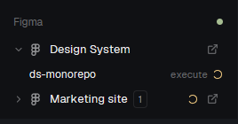

# Figma Bridge for Herdr

A sidebar section for the [Herdr](https://herdr.dev) desktop app that shows which Figma files are connected to the [figma-console-mcp](https://github.com/southleft/figma-console-mcp) bridge, and which agent is working on each one.

## What it adds

- **A bridge light** in the section's heading: green with a file connected, yellow with a bridge running but no file, grey with no bridge.
- **The connected Figma files**, each with a button that opens it in the browser.
- **The agent on each file**: the Herdr agent whose session last called Figma on that file. While it is calling Figma it shows the tool it is running and a spinner; afterwards, how long ago. Click it to go to that agent's terminal. Click a file to fold its agents away; folded, it shows how many there are and still spins while one is at work.

It is read-only. It never talks to Figma and never sends anything to the bridge except a health request.

## Requirements

- figma-console-mcp in local (Desktop Bridge plugin) mode, 1.46 or a version with the same port files and `/health` endpoint.
- Node.js on `PATH` (the bridge needs it too).
- Agent binding works for Claude Code sessions. Other agents' bridges count toward the light, but their files and activity are not shown.

## Install

Ask your Herdr agent:

> Read ~/.config/herdr-app/AGENTS.md, then add this mod: https://github.com/cris-achiardi/herdr-mods/tree/main/figma-bridge

It follows [RECIPE.md](RECIPE.md). Installation has two parts:

1. Copy `mods/figma-bridge/` into `~/.config/herdr-app/mods/`.
2. **Give it a place.** `mod.json` uses `"place": "none"`. Add a `figma-bridge` block to your layout's sidebar, under the agents list. RECIPE.md has the edit.

Herdr's shipped layouts are read-only and restored on every start, so on a stock setup step 2 means cloning the `main` layout and editing the clone.

## What it runs

Every 3 seconds while the section is on screen, `node mods/figma-bridge/probe.cjs`, which:

- reads the bridge's port files, `figma-console-mcp-<port>.json` in the system temp folder;
- requests `http://localhost:<port>/health` from each bridge;
- lists processes once per new bridge (`Get-CimInstance Win32_Process` on Windows, `ps` elsewhere) to find the terminal the bridge was started from;
- reads `~/.claude/sessions/<pid>.json` and the appended part of that session's transcript under `~/.claude/projects/`, keeping only figma-console tool calls: tool name, time, file key, file name and page;
- writes its own bookkeeping to `herdr-figma-bridge.json` in the system temp folder.

Nothing leaves the computer. The system browser opens when you click a file's button.

## Limits

- **A file has no name until an agent asks the bridge.** The bridge reports how many files are connected, not which. Names come from the bridge's answers to an agent (`figma_get_status`, `figma_list_open_files`, …). Until then the section says "1 file connected".
- When a file is closed, the list drops the least recently seen one, which is a guess until an agent asks again.
- Work a session hands to subagents is not seen.
- Agents on other machines are not covered.
- Built and used on Windows with Herdr 0.1.15, figma-console-mcp 1.46 and Claude Code 2.1. macOS and Linux are untested.

## License

MIT, see [LICENSE](../LICENSE). Icons are drawn after [Lucide](https://lucide.dev) (ISC, see `mods/figma-bridge/LICENSE-lucide.txt`).
