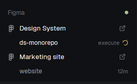

# Figma Bridge

A sidebar section that lists the Figma files connected to the figma-console-mcp bridge (its Desktop Bridge plugin) and, under each file, the agent that last worked on it. Its heading carries a light for the bridge's state. It sits in the left sidebar under the agents list. It is read-only.



## What you see

A section that fills its block: `chrome` background, 1px `border` above, text 13px in `foreground`.

**Heading**, 41px (14px top, 5px bottom, 16px side padding): "Figma" in 11.5px medium `dim`, and at the right a 7px dot, the light: `ansi2` when at least one file is connected, `ansi3` when a bridge answers but no file is connected, `dim` when no bridge answers, `ansi1` on an error. Its tooltip says which.

**File row**, 30px, 8px side padding, 6px gaps, radius 8, `hover` on hover: a 12px chevron in `dim`, down when open and right when folded (a 12px blank for a file with no agent); a 14px Figma icon in `muted`; the file name, truncated (tooltip: name and current page); when folded, the number of its agents in a 10px `muted` badge with a 1px `border`, and at the right a 12px `working` spinner if one of them is active; a 22px button with a 13px external-link icon in `dim` (`selected` background and `foreground` on hover), tooltip "Open in browser".

**Agent row**, under its open file, 26px, 26px left and 8px right padding, radius 8, 12px text: the agent's program icon (13px), its space name (at most 110px), its tab name in 11px `dim` taking the rest, then:

- while active: the tool it last ran without its `figma_` prefix and with spaces ("execute", "get status") in 11px `dim`, and a 12px spinner in `working` turning once per 900 ms; the row's text is `foreground`;
- otherwise: the time since its last Figma call (`now`, `5m`, `3h`, `2d`) in 11px `dim`; the row's text is `muted`.

The row of the focused agent is `selected`. A session that is not in a Herdr terminal shows its Claude Code session name and is not clickable.

**Unnamed files**: one 30px row in `dim`, "1 file connected" / "2 more files connected", for connected files whose names are not known yet.

**Messages** replace the rows, a `muted` 12px title and an 11px `dim` sentence: "No bridge running", "No file connected", "Node.js not found", "Couldn't read the bridge".

## How it behaves

- An agent is active while one of its figma-console calls has no answer yet, and for 45 s after its last call or answer.
- A file lists the sessions whose most recent figma-console call targeted it: the call's `fileKey` or Figma URL, else the bridge's active file as last reported to that session.
- Clicking a file row that has agents folds or unfolds them. Folded files are kept in `localStorage` by file key.
- Clicking an agent row focuses that agent's pane. Clicking a file's button opens `https://www.figma.com/file/<key>` in the system browser.
- It reloads every 3 s while its layout block is shown; a hidden block runs nothing.
- The block resizes itself with `layout.resize` to the height of its content with every file unfolded, up to 300px, then scrolls. Folding a file leaves the block's size unchanged. It does so once the first probe has returned, not before.
- Dragging the block's edge to another height stops that: the block keeps the dragged height whatever is listed, scrolling when the rows don't fit, and across restarts (Herdr keeps the size in `layouts/.state/`; the mod keeps `fit` in `localStorage`: `[height it last asked for or saw, whether the person's height is kept, the height it replaced until the asked one is seen, then the same as the first]`, written whenever one of them changes). Dragging the edge back to within 8px of the content's height makes the block fit itself again.
- Agent statuses (working, blocked, done, idle) are not shown; only Figma activity is.

## Built from

- `mods/figma-bridge/`: `main.js`, `probe.cjs`, `mod.json` `{ "place": "none" }`, icons `figma`, `external`, `spinner`, `chevron-down`, `chevron-right` (drawn after Lucide) and `LICENSE-lucide.txt`.
- `main.js`: one `View`. `herdr` functions: `agents`, `panes`, `terminals`, `exec`, `theme`, `layout`, `props`, `appHome`, `run`. Commands: `pane.focus {pane}`, `layout.resize {id, px}`. `cx.open_url`, `cx.timer.every`. It runs `node <appHome>/mods/figma-bridge/probe.cjs` (20 s timeout) and draws its JSON. `props { demo: true }` draws two sample files at 268px wide and runs nothing; `folded: ["b"]` starts the second one folded.
- `probe.cjs` (CommonJS, Node 14+, no dependencies; no `fetch`, which needs 18, since Herdr's `node` can be older than the terminal's) prints `{ now, connected, unnamed, files: [{ key, name, page, url, agents: [{ session, name, cwd, ancestors, tool, at, calling }] }], bridges: [{ port, up, version, connected, session, ancestors }] }`:
  1. Bridges: every `figma-console-mcp-<port>.json` in `os.tmpdir()` whose `pid` is alive; `GET /health` with the `http` module (1.5 s), at `::1` and then `127.0.0.1`, gives `connectedClients`. IPv6 first: the bridge listens on `::1`, and Node < 17 resolves `localhost` to IPv4 first, where another bridge can hold the same port. `connected` is the largest of them: the plugin connects each file to every bridge.
  2. Ancestors of each bridge's pid from the process table (`Get-CimInstance Win32_Process` through PowerShell on Windows, `ps -A -o pid=,ppid=` elsewhere), cached per bridge pid and start time.
  3. Session: the first ancestor with `~/.claude/sessions/<pid>.json`, which gives `sessionId`, `cwd`, `name`. Its transcript is `~/.claude/projects/<cwd with every non-alphanumeric as ->/<sessionId>.jsonl`, else that file name in any project folder.
  4. Transcript: read from the cached byte offset to the last newline. In assistant `tool_use` blocks whose name matches `mcp__figma-console*__<tool>`: remember the call (time, `input.fileKey` or the key in `input.url`). In `tool_result` blocks answering one: every `"fileName":"…","fileKey":"…"[,"currentPage":"…"]` names a file; `"connectedFile":{…}` is the session's active file; a result with `"connectedFiles":[` is a full listing. Calls unanswered after 5 minutes are dropped.
  5. Files shown: known files ordered by (seen after the newest full listing, in that listing, other), then most recently seen, cut to `connected`; `unnamed` is the rest of the count.
  6. State (`procs`, `scans`) is written atomically to `herdr-figma-bridge.json` in `os.tmpdir()`.
- Session to agent, in `main.js`: the entry of `terminals()` whose `pid` or `foreground.pid` is among the session's `ancestors`, then `agents()` by `address`; failing that, an agent pane whose `cwd` is the session's.

**Wiring it into the window.** Shipped layouts are read-only and restored on every start: if the person's layout is shipped, clone it (`layout.clone`) and edit the clone. In the sidebar's lists column (`sidebar-lists` in the `main` layout, 0.1.15), after the agents block:

```json
{ "id": "figma", "type": "block", "content": { "mod": "figma-bridge" }, "size": { "px": 97 } }
```

Without a layout change: `herdr-app do pane.split '{"direction":"right","mod":"figma-bridge"}'` opens it as a pane.

## Watch out

- Copying the folder alone shows nothing; the install is done when the section is in the sidebar.
- `/health` gives counts, never file names. Don't connect to the bridge's WebSocket to ask: the bridge would treat the connection as a Figma file.
- A session can own two bridges (the server configured twice). Count files with the maximum over bridges, not the sum, and scan a session's transcript once.
- Transcripts grow to many megabytes and hold screenshots: read only the appended bytes, and skip lines that neither name `mcp__figma-console` nor contain a waiting call's id before parsing them.
- Tool results never repeat the tool's name; they are matched to calls by `tool_use_id`.
- Page names can start with spaces and tree characters ("   ├ Combobox"); strip leading non-letters for display.
- `probe.cjs` must keep the `.cjs` extension: Herdr reads `.js` in a mod folder as a module.
- The block is found by `content.mod === "figma-bridge"`; a renamed copy must update that constant and the probe's path.
- `layout.resize` only works on a personal layout. In a shipped one the block keeps the size the layout gives it.
- A drag is told from the mod's own resize by the block's `size.px` in `layout()`: it is a drag when it is neither the height the mod last asked for nor the one that was there before it asked (`layout()` can still show that one on the next render, and always does in a shipped layout). Once the asked height is seen, the one before it is no longer excused; with nothing stored, the first height seen is the baseline. There is no resize event. A layout that stored another height than the one asked for (a clamp) would read as a drag.
- While the block fits itself, `layout.resize` with a smaller `px` hands the difference to the weighted blocks above (`spaces`, `agents`) and moves this section's heading down by as much: a file disconnecting lowers the heading. A dragged height doesn't move. The order of the layout's nodes never changes.
- Built and used on Windows with Herdr 0.1.15, figma-console-mcp 1.46, Claude Code 2.1.325. Untested on macOS and Linux, and with agents other than Claude Code (their bridges light the dot, nothing more).

## Done when

- `herdr-app check` passes for `mods/figma-bridge`; `herdr-app status` shows no errors.
- `node probe.cjs` prints JSON in well under a second on its second run.
- With no agent running the section says "No bridge running" and the light is grey; with an agent that has figma-console and no plugin open, "No file connected" and a yellow light.
- With the Desktop Bridge plugin open in a file and after an agent's `figma_get_status`, the file's name shows with that agent under it, the light is green, and the agent row spins while it calls Figma.
- Closing the plugin in a connected file removes its row and the block shrinks to what is left. After its edge is dragged, the block and the heading stay where they are whatever connects or disconnects, also after a restart; dragged back to about the content's height, it fits itself again.
- Clicking the file row hides its agent rows and shows their count, and a spinner while one is calling Figma; clicking again shows them; the choice survives a restart.
- Clicking the agent row focuses its terminal; the file's button opens the file in the browser.
