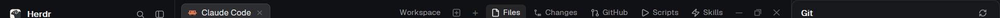

# File Import

A file-import button in the tab bar: opens the system file picker; pastes the selected paths into the focused terminal, quoted and space-separated.



## What you see

**The button**: in the tab bar, after the Workspace link (if installed) and immediately before the `+` (new tab) button. A 16px document-with-plus icon (`mods/file-import/import.svg`) in `dim`; on hover `hover` background and `foreground` icon.

**The dialog**: 340px wide, 148px tall, on `popover`. A header row with the import icon, "Import files" in 15px semibold, and "Esc" in `dim` at the right. Below it, one line of `muted` instruction text. At the bottom right, a "Cancel" button (height 30, px 14, radius 8, `input` border, `raised` bg). The OS file picker opens immediately on top; the dialog disappears once it resolves or is cancelled.

## How it behaves

- The dialog spawns the system picker (`pickFiles { multiple: true }`) in `init` before the first render. The picker appears over the dialog.
- When the person confirms: the dialog closes, then `hc send <terminal> "<path1>" "<path2>"` runs against the focused terminal's address.
- When the person cancels the picker, presses Esc, or clicks Cancel: the dialog closes and nothing is sent.
- If no terminal is focused at confirm time, the paths are silently dropped and the dialog closes.

## Built from

- `mods/file-import/`: `main.js` and `mod.json` `{ "place": "none", "title": "Import files" }`. Nothing docks by itself.
- `herdr` functions: `pickFiles`, `hc`, `panes`, `props`, `closeOverlay`, `theme`. `gpui-kit`: `View`, `div`, `svg`. `gpui-base`: `v_flex`, `h_flex`.
- Opened by the tab bar button, not by this mod.

**Wiring the button.** Shipped mods and layouts are read-only and restored on every start. If the person's layout or tab bar mod is shipped, clone it (`mod.clone`, `layout.clone`) and edit the clone. If they already have their own tab bar mod, add the button there.

In a tab bar mod based on Herdr's `tabs` (0.1.15), insert after the Workspace link (or directly before `tab-new` if Workspace is not installed):

```js
// File import: opens the system picker; paths land in the focused terminal.
.child(button("tab-import", svg("mods/file-import/import.svg").size(14),
  () => openOverlay({ mod: "file-import", kind: "dialog", width: 340, height: 148 })))
```

(`button` is the tab bar's existing helper: `(id, label, action) => div().id(id).size(26)…on_click(action).child(label)`.)

## Watch out

- Copying the folder alone shows nothing. The install is not done until clicking the button opens the picker.
- The dialog's height must match the layout: `p(18) + gap(8) × 2 + header(~22) + text(~18) + flex_1 + cancel(30) + p(18)` ≈ 148px. Adjust if you change the padding or add rows.
- `hc send` pastes the string as if typed; paths with `"` in their name will break the quoting. This is a known limit.
- `herdr-app check` loads the mod with no props; it passes without a tab bar wired. To test the dialog manually: `herdr-app do mod.open '{"name":"file-import"}'`.
- Built and used on Windows with Herdr 0.1.15. Untested on macOS and Linux.

## Done when

- `herdr-app check` passes for `mods/file-import` and for each tab bar mod that was edited; `herdr-app status` shows no errors.
- Clicking the button in the tab bar opens the small dialog and immediately shows the OS file picker.
- Confirming one or more files closes the dialog and pastes the quoted paths into the focused terminal.
- Pressing Esc or Cancel closes the dialog without sending anything.
