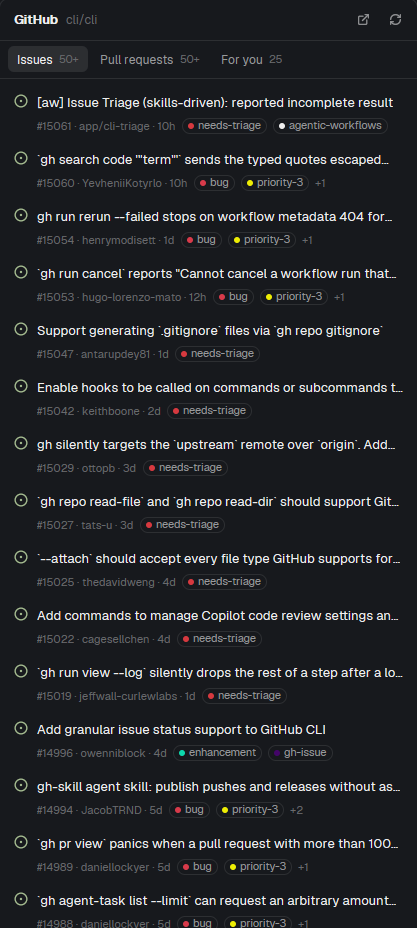

# GitHub panel for Herdr

A side panel for the [Herdr](https://herdr.dev) desktop app that lists the open GitHub issues and pull requests of the repository you are working in, and everything on GitHub that is waiting on you, next to the Files, Changes and Git panels. Click one to read its description and conversation without leaving the terminal.



## What it adds

- **Issues** and **Pull requests** lists for the repository of the focused terminal, with author, age and labels. Pull requests also show draft state, whether their checks pass, and the review decision.
- **For you**, a third tab: the open items in any repository that ask for your review, mention you, are assigned to you, or are your own pull requests, grouped in that order. A switch narrows it to the repository you are in. Items with something unread on GitHub carry a dot.
- **A detail view** per issue or pull request: state, branch and diff size (pull requests), labels, the description and every comment and review, rendered as markdown.
- **Right-click a row** for Open in browser and Copy URL, without opening it in the panel first.
- **Open on GitHub** and **Copy link** for the open item, and a link to the repository's issue or pull request page.
- It follows you: focus a terminal in another repository and the panel shows that one.

It is read-only. It never comments, closes, merges or checks anything out.

## Requirements

The [GitHub CLI](https://cli.github.com) (`gh`), signed in with `gh auth login`. The panel says so when it is missing or signed out.

## Install

Ask your Herdr agent:

> Read ~/.config/herdr-app/AGENTS.md, then add this mod: https://github.com/cris-achiardi/herdr-mods/tree/main/github

It follows [RECIPE.md](RECIPE.md). Installation has two parts:

1. Copy `mods/github/` into `~/.config/herdr-app/mods/`.
2. **Give it a place and a button.** `mod.json` uses `"place": "none"`, so copying the folder alone shows nothing. Add a `github` block to your layout's `panel-body` stack and a GitHub button to your tab bar mod. RECIPE.md has both edits.

Herdr's shipped layouts and mods are read-only and restored on every start, so on a stock setup step 2 means cloning the `main` layout and the `tabs` mod and editing the clones.

### Without touching the layout

Open it as a pane beside your terminal:

```sh
herdr-app do pane.split '{"direction":"right","mod":"github"}'
```

Props: `repo` (`"owner/name"`) pins the pane to one repository whatever the folder; `tab` (`"issues"` or `"prs"`) chooses the list it starts on; `open` (a number) starts on that issue or pull request.

## What it runs

- `git rev-parse --show-toplevel` in the focused terminal's folder, to find the repository.
- `gh repo view`, `gh issue list`, `gh pr list`, and `gh issue view` / `gh pr view` for the item you open. These reach GitHub over the network with your `gh` login. On a space that lives on another machine, they run there.
- For the "For you" tab: `gh api graphql` (four searches for your open items) and `gh api notifications` (to mark the unread ones), always on this computer.
- It sets one shared value, `github.attention`: how many review requests and mentions are unread. A tab bar can show a dot from it; RECIPE.md has the edit.
- The system browser, when you click Open on GitHub. The clipboard, when you click Copy link.

It reads no files and writes nothing.

## Limits

- Open items only, the 50 most recently created of each kind. Closed and merged ones are not listed.
- The lists reload every two minutes while the panel is shown, when you press refresh, and when you move to another repository. A hidden panel asks only for "For you", every five minutes.
- "For you" lists up to 50 items per group, for the account `gh` is signed in with. It needs a token that can read notifications to show the unread dots (the default `gh auth login` scopes are enough).
- No filters, search or keyboard navigation yet.
- The repository is the one `gh` picks for the folder (for a fork, the one you chose with `gh repo set-default`).
- Images in descriptions and comments are not drawn.
- Built and used on Windows with Herdr 0.1.15. macOS and Linux are untested.

## License

MIT, see [LICENSE](../LICENSE). Icons are drawn after [Lucide](https://lucide.dev) (ISC, see `mods/github/LICENSE-lucide.txt`).
