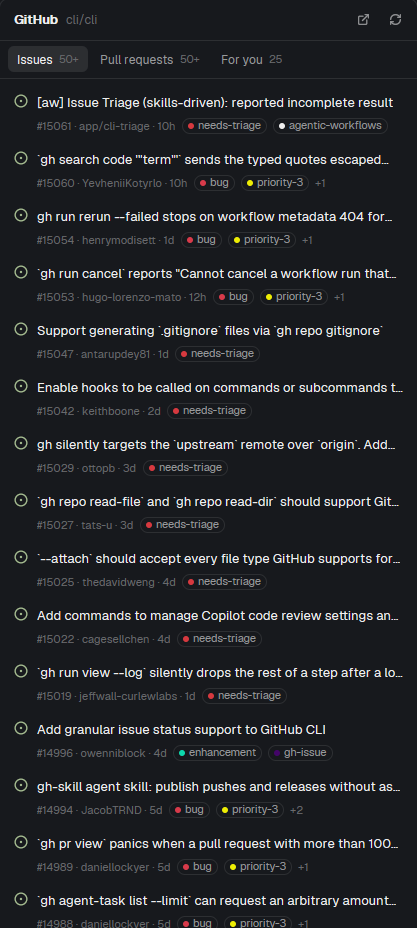

# GitHub

A side panel that lists the open GitHub issues and pull requests of the repository the focused terminal is in, read with the GitHub CLI, and in a third tab the ones in any repository that wait on the signed-in person. A row opens that item's description and conversation in the same panel. It sits in the right panel beside Files, Changes and Git, opened from a GitHub button in the tab bar. It is read-only.



## What you see

A card that fills its block: `background`, 1px `border`, radius 10, text 13px in `foreground`.

**Header**, 42px, 14px left padding, 9px right, 1px `border` below: "GitHub" semibold; the repository as `owner/name` in 12px `dim`, truncated, taking the remaining width; then 24px icon buttons (13px icon in `muted`, radius 6, `hover` background and `foreground` icon on hover): an external-link button once the repository is known, and refresh, whose icon spins (one turn per 900 ms) while loading.

**Tabs**, 38px, 8px side padding, 1px `border` below: three pills 26px high, radius 6, 12px text, "Issues", "Pull requests" and "For you", each followed by its count in 10.5px `dim` (`50+` at the limit for the first two; for "For you" the number of rows it lists). The chosen one is `selected` with `foreground` text; the other is `muted`.

**List**, scrolling, 6px padding. A row has 8px side and 7px vertical padding, radius 7, `hover` on hover:

- a 14px state icon: issue (circle with a dot) in `ansi2`; pull request in `ansi2`, or the dashed draft icon in `dim` for a draft;
- the title on one line, truncated;
- below it in 11px `dim`: `#number · author · age` (age as `now`, `5m`, `3h`, `2d`, `4mo`, `1y` since the last update); for a pull request with checks a 7px dot (`ansi2` pass, `ansi1` fail, `ansi3` running) and "Approved" in `ansi2` or "Changes requested" in `ansi1`; then up to two labels and `+n` for the rest. A label is a 16px pill with a 1px `border`, a 6px dot in the label's own color and its name in 10.5px `muted` (at most 96px).

An empty list reads "No open issues" / "No open pull requests", "Loading…" while loading, or GitHub's reason when that list failed (issues disabled). At 50 rows a last line reads "Showing the 50 most recently created".

**For you**, in place of the list when that tab is chosen, scrolling, 6px padding:

- A 30px row with two pills 22px high, radius 5, 11.5px text, "All repos" and "This repo"; the chosen one is `selected` with `foreground` text, the other `muted`. With "This repo" chosen the repository's `owner/name` follows in 11px `dim`.
- Up to four groups, each under a 28px heading in 11.5px `dim` (the title in medium weight, then its count in 10.5px): "Review requested", "Mentioned", "Assigned to you", "Your pull requests". A group with no rows is not drawn.
- Rows are the list's rows, with two differences: under "All repos" the second line starts with `owner/name#number` instead of `#number`; and an item with an unread GitHub notification has a 7px `accent` dot after its title (tooltip "Unread on GitHub").
- Empty: "Nothing is waiting for you." / "Nothing is waiting for you in owner/name.", "Loading…" before the first answer, or "This folder isn't a GitHub repository. Switch to All repos."
- A failure shows a semibold title and a `muted` sentence under the pills, as Problems do.

**Detail**, in place of the tabs and list. The header becomes: a back arrow, `#number` semibold, the repository, then copy link (a check for 1.5 s after copying), open on GitHub, refresh. Below, scrolling, 14px padding, 10px gaps:

1. the title, 14px semibold, wrapping;
2. a wrapping line in 11.5px `muted`: a 20px state pill with a 1px border and text in the state's color (Open `ansi2`; Closed issue `ansi5`; Closed pull request `ansi1`; Merged `ansi5`; Draft `dim`), `author · opened <age> ago`, and for a pull request the checks dot with "Checks pass" / "Checks fail" / "Checks running" and the review decision ("Approved", "Changes requested", "Review required");
3. pull requests: `head → base` in the terminal font, `N files`, `+additions` in `ansi2`, `−deletions` in `ansi1`, 11px;
4. the labels, wrapping;
5. a 1px `border` rule, then the description as markdown ("No description." in `dim` when empty), then each comment and each review that has text, oldest first: a 1px `border` line above, the author semibold, `<age> ago` in `dim`, for a review `· Approved` etc., and the body as markdown.

Until the detail arrives the title and state come from the list row and the body reads "Loading…".

**Row menu**: a popup at the pointer, 200×72px on `popover`, 5px padding, text 12.8px. Two rows, each 31px high, 8px side padding, radius 7, a 14px `muted` icon, 9px gap and a label: "Open in browser" (external-link icon) and "Copy URL" (link icon). The highlighted row is `selected`, the first one to begin with; hovered rows are `hover`.

**Problems** replace the list of the Issues and Pull requests tabs (the tabs stay, and "For you" keeps working) with a title (semibold) and one `muted` sentence: "Not a git repository" / "No folder", "GitHub CLI not found", "Not signed in to GitHub", "Not a GitHub repository", "GitHub didn't answer", or "Couldn't load from GitHub" with the first line of `gh`'s error.

## How it behaves

- Agent statuses (working, blocked, done, idle) are not shown. Only the refresh icon animates.
- The repository is found from the focused pane's live folder (else the focused terminal's, else the active space's folder), on that space's machine, exactly as the shipped `changes` mod does. Focusing a terminal in another repository reloads the panel for it; another folder of the same repository reloads nothing.
- It reloads when shown data is older than 2 minutes, checked every 3 s, and when refresh is clicked. While its layout block is hidden, or is not the shown child of its stack, it makes no requests; it catches up within 3 s of being shown.
- Clicking a tab switches lists; the choice is kept in `localStorage`. Both repository lists load together.
- "For you" is loaded once for every repository and does not depend on the folder: "This repo" filters the same rows by repository, so switching asks nothing. The scope is kept in `localStorage`. It reloads when older than 2 minutes while the panel is shown, and every 5 minutes while it is hidden, which keeps the attention count current.
- An item found by several of its searches is listed once, in the first of: Review requested, Mentioned, Your pull requests, Assigned to you. The groups are drawn in the order Review requested, Mentioned, Assigned to you, Your pull requests.
- The attention count, `shared("github.attention")`, is the number of rows under Review requested and Mentioned that have an unread notification whose reason is `review_requested` or `mention`. A tab bar can show a dot on its GitHub button from it.
- An item opened from "For you" is read from its own repository and stays open when the focused terminal moves to another repository.
- Right-clicking a row, issue or pull request, opens the row menu. Open in browser opens that item's GitHub page in the system browser; Copy URL puts its URL on the clipboard. Either closes the menu. Up/down move the highlight, Enter runs the row, Esc or a click elsewhere closes it.
- Clicking a row opens its detail and loads it. The back arrow returns to the list. A reload also reloads the open detail.
- The header's external-link button opens the repository's `/issues` or `/pulls` page (the shown tab), or `https://github.com/notifications` on "For you"; in a detail it opens the item. Copy link puts the item's URL on the clipboard.
- Nothing is written to GitHub or to the repository.

## Built from

- `mods/github/`: `main.js`, `mod.json` `{ "place": "none" }`, its icons (`issue`, `issue-closed`, `pr`, `pr-draft`, `merged`, `external`, `refresh`, `back`, `link`, `check`, drawn after Lucide) and `LICENSE-lucide.txt`.
- `main.js`: one `View` with two roles. `props().role === "menu"` is the row menu, with `props.url`; the panel opens it with `openOverlay({ mod: "github", kind: "popup", at: "pointer", width: 200, height: 72, props: { role: "menu", url } })` from the row's `.on_mouse_down("right", …)`, stopping propagation. Otherwise it is the panel. The panel's props, all optional: `repo` (`"owner/name"`: skip the folder, pass `-R repo` to every `gh` call), `tab` (`"issues"` | `"prs"` | `"foryou"`), `scope` (`"all"` | `"repo"`, for "For you"), `open` (a number: start on that item of `tab`, not for "For you").
- `herdr` functions: `spaces`, `panes`, `focused`, `exec`, `theme`, `layout`, `settings`, `props`, `openOverlay`, `closeOverlay`, `setShared`. `gpui-base`: `v_flex`, `h_flex`, `TextView.markdown(id, text).selectable(true)`. `cx.open_url`, `cx.write_to_clipboard`, `cx.timer.every`, `cx.timer.after`. No app commands.
- Programs, each with `cwd` the repository root, `on` the space's machine and a 20 s timeout:
  - `git rev-parse --show-toplevel`
  - `gh repo view --json nameWithOwner,url`
  - `gh issue list --limit 50 --json number,title,author,labels,updatedAt,url,state`
  - `gh pr list --limit 50 --json number,title,author,labels,updatedAt,url,state,isDraft,reviewDecision,statusCheckRollup,headRefName`
  - `gh issue view <n> --json number,title,body,author,state,createdAt,updatedAt,labels,comments,url`
  - `gh pr view <n> --json number,title,body,author,state,createdAt,updatedAt,labels,comments,reviews,url,isDraft,reviewDecision,statusCheckRollup,headRefName,baseRefName,additions,deletions,changedFiles`
- "For you", two programs run on this computer with no `cwd`, whatever machine the space is on:
  - `gh api graphql -f query=<Q> -f review=… -f mentions=… -f assigned=… -f mine=…`. `<Q>` is one query with four aliased `search(query: $x, type: ISSUE, first: 50) { issueCount nodes { … } }`; on `Issue`: `number title url state updatedAt author{login} repository{nameWithOwner} labels(first:5){nodes{name color}}`; on `PullRequest` the same plus `isDraft reviewDecision commits(last:1){nodes{commit{statusCheckRollup{state}}}}`. The four search strings are `is:open archived:false <q> sort:updated-desc` with `<q>`: `is:pr review-requested:@me`, `mentions:@me`, `assignee:@me`, `is:pr author:@me`. Checks here come from the rollup's `state`: `SUCCESS` pass, `FAILURE` or `ERROR` fail, anything else running, none: nothing.
  - `gh api notifications --paginate -q <jq>`, the unread notifications as `owner/name#number reason` lines, where `<jq>` keeps entries whose `subject.url` ends in `repos/<owner>/<name>/(issues|pulls)/<number>`. If this call fails the rows simply have no unread dots and the attention count is left as it was.
  - A detail from "For you": the `gh issue view` / `gh pr view` above with `-R owner/name`.
- Checks, from `statusCheckRollup`: fail if any entry's `conclusion` or `state` is `FAILURE`, `ERROR`, `TIMED_OUT`, `CANCELLED`, `ACTION_REQUIRED` or `STARTUP_FAILURE`; else running if a check run's `status` isn't `COMPLETED` or a status context's `state` is `PENDING` or `EXPECTED`; else pass. No entries: nothing shown.

**Wiring it into the window.** Shipped layouts and mods are read-only and restored on every start: if the person's layout or tab bar is shipped, clone them (`layout.clone`, `mod.clone`), point the cloned layout's `tabs` block at the cloned tab bar, and edit the clones. If the person already has their own, ask whether to change it or make a new one.

- Layout: in the `panel-body` stack of the `main` layout (0.1.15), add a child:

  ```json
  { "id": "github", "type": "block", "content": { "mod": "github" } }
  ```

- Tab bar (the `tabs` mod, 0.1.15): the panel buttons come from `enabled`, and a space's remembered panel is only restored when `enabled` includes it. Add `"github"` to it and one button after the others:

  ```js
  const enabled = [...(shared("workspace.panels") ?? ["files", "changes"]), "github"];
  …
  .child(panelButton("github", "GitHub", "mods/github/pr.svg"))
  ```

  Optional, the attention dot: give `panelButton` a fourth argument and draw a 6px `accent` dot after the label when it is true, then pass `shared("github.attention") > 0` for the GitHub button.

- No layout change at all: `herdr-app do pane.split '{"direction":"right","mod":"github"}'` opens it as a pane.

## Watch out

- Copying the folder alone shows nothing. The install is not done until the person can open the panel from their tab bar, or chose the pane instead.
- `exec` rejects when `gh` isn't installed, and resolves with a nonzero `code` when `gh` itself fails (signed out, no GitHub remote, issues disabled). They are different messages. One list failing (issues disabled) must not blank the other.
- Don't ask `gh issue list` / `gh pr list` for `comments` or `body`: with 50 rows that is megabytes and seconds. `statusCheckRollup` alone makes the pull request list about 200 KB on a busy repository.
- A hidden copy's timers keep running, so the reload timer checks `layout()` for its own block (hidden, or not its stack's `active` child) before calling GitHub. A copy that isn't in the layout (a pane) counts as shown. The block is found by `content.mod === "github"`: a renamed copy must update that constant.
- Key the loaded data on the repository root, not on the folder, or every focus change between two terminals of one repository refetches.
- `gh pr list --state closed` leaves out merged pull requests; a Closed filter needs `--state all` or `merged` handled separately. This build lists open items only.
- Every `TextView.markdown` needs its own id (item and comment index), or one comment's text shows in another.
- `.when(cond, …)` needs a real boolean.
- "For you" must not wait on the repository: it loads from `init` and from its own clock, and it draws when the folder isn't a repository at all. Only `gh` missing or signed out stops it.
- Its searches overlap heavily (a pull request you were asked to review usually mentions you too). Without the claim order the same row shows three times.
- `gh search` cannot return checks or the review decision; that is why this is one GraphQL request. It takes about 3 s.
- Unread notifications name items by API URL; a notification for a commit, a release or a discussion has no such URL and is skipped.
- The `shared` key is one number for the whole app: only review requests and mentions count, or the dot never goes out for someone assigned many issues.
- A popup's tasks end when it closes: the menu calls `cx.open_url` or `cx.write_to_clipboard` first, then `closeOverlay`. The menu role must not start the panel's timer or loads.
- `herdr-app check` renders the first frame only (loading). To see lists and a detail without a GitHub repository at hand: `herdr-app do pane.split '{"direction":"right","mod":"github","props":{"repo":"cli/cli","tab":"prs","open":<number>}}'`.
- Built and used on Windows with Herdr 0.1.15 and gh 2.85. Untested on macOS, Linux and remote machines.

## Done when

- `herdr-app check` passes for `mods/github` and for the tab bar mod that was edited; `herdr-app status` shows no errors.
- The tab bar has a GitHub button; clicking it shows the panel, clicking it again hides it.
- In a repository on GitHub the header shows `owner/name`, and both tabs show their counts and rows that match `gh issue list` and `gh pr list`.
- Right-clicking a row, in either list, shows a two-item menu; Open in browser opens that item in the browser, Copy URL puts its URL on the clipboard, and the panel stays on the list.
- The "For you" tab's count equals the rows it lists; "All repos" shows items from repositories other than the folder's, each named `owner/name#number`; "This repo" shows only the folder's, with no request made on switching.
- A pull request that asks for your review appears once, under Review requested, even though it also mentions you.
- In a folder that isn't a repository, Issues and Pull requests show "Not a git repository" and "For you" still lists "All repos".
- An item opened from "For you" in another repository shows its conversation, and the header names that repository.
- Clicking a row shows its description and comments; the back arrow returns to the list; Open on GitHub opens that item in the browser.
- Focusing a terminal in a folder that isn't a repository shows "Not a git repository"; focusing one in another GitHub repository shows that repository's lists.
- With the panel hidden, the only `gh` processes started are the two "For you" calls, every 5 minutes.
