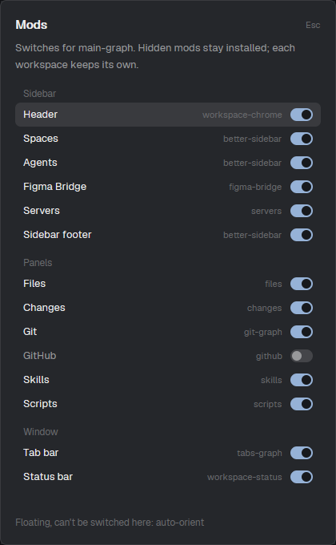

# Mod Switches

A dialog, opened with **Ctrl+Shift+M**, with an on/off switch for every mod on screen: the sidebar sections, the right-hand panels, the tab bar and the status bar. Switching one off hides it without uninstalling anything, and each layout keeps its own switches, so it pairs with [Workspaces](../workspaces/).

## What it does

- Lists every block of the shown layout that holds a mod, grouped **Sidebar**, **Panels** and **Window**, each with the mod's folder name and a switch.
- A click, or Enter/Space on the highlighted row, flips the switch at once. ↑/↓ move, Esc or Ctrl+Shift+M closes.
- Off means hidden: Herdr's `layout.toggle` sets the block aside in that layout and remembers it. The mod stays installed and comes back with its switch.
- With the tab bar change in the recipe, a hidden panel also loses its button in the tab bar (Files, Changes, Git, GitHub, …).
- Floating mods are named at the bottom but get no switch: Herdr's hide command doesn't reach them.

## Install

Ask your Herdr agent:

> Read ~/.config/herdr-app/AGENTS.md, then add this mod: https://github.com/cris-achiardi/herdr-mods/tree/main/mod-switches

It follows [RECIPE.md](RECIPE.md). Installation has three parts:

1. Copy `mods/mod-switches/` into `~/.config/herdr-app/mods/`.
2. Bind the key: `"ctrl-shift-m": "mod.open:mod-switches"` in the `global` section of `~/.config/herdr-app/keys.json`.
3. Optional: in the person's own tab bar mod, skip the button of a hidden panel.

## What it runs

- `layout()`, `shared("layout")`, `readTextFile` (each listed mod's `mod.json`, for its title) and the app command `layout.toggle {id}`. No programs, no network.

## Limits

- Floating mods can't be switched.
- On Herdr's shipped layouts the switches still work (hiding is one of the things a shipped layout keeps), but Herdr's own tab bar keeps the buttons of hidden panels.
- Switching off the tab bar or the sidebar's header hides it like any other block; Ctrl+Shift+M brings it back.
- Built and used on Windows with Herdr 0.1.15. Untested on macOS and Linux.
