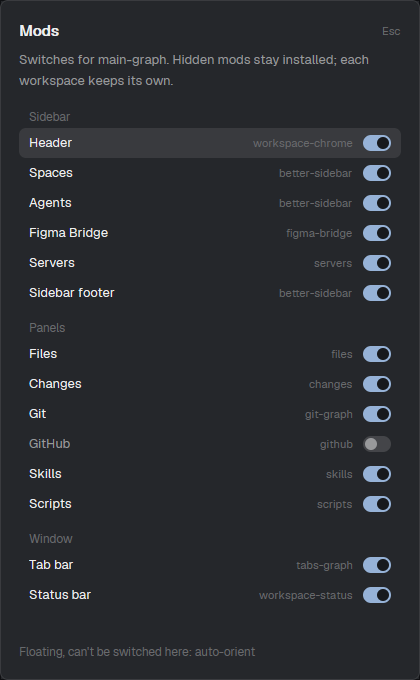

# Mod Switches

A dialog with an on/off switch for every mod block in the shown layout. A switch runs `layout.toggle {id}`: the block is hidden, not uninstalled, and the choice is stored with that layout. Opened by a key bound to `mod.open:mod-switches`.



## What you see

A dialog 420×680px on `popover`, 18px padding, text 12.8px.

- Header: "Mods" at 15px semibold, `Esc` in 11px `dim` at the right. Under it, in `muted`: "Switches for <layout>. Hidden mods stay installed; each workspace keeps its own." (`<layout>` is the layout's file name, `clean` reads "Herdr clean").
- A scrolling list in groups, each headed by an 11.5px `dim` label (10px above, 2px below, 10px side padding): **Sidebar** (blocks under the node `sidebar`), **Panels** (under `panel-body`), **Window** (the rest). Empty groups are left out.
- Rows 30px high, 10px side padding, radius 7, gap 10: the name (truncated; `foreground` when on, `muted` when off), the mod's folder in 11px `dim`, and a switch: 28×16, radius 8, 2px padding, a 12px round knob, `accent` with an `accent_foreground` knob at the right when on, `input` with a `muted` knob at the left when off. The highlighted row is `selected`, hovered rows `hover`.
- Names: fixed for the usual ids (`brand` Header, `tabs` Tab bar, `status` Status bar, `graph` Git, `github` GitHub, `skills` Skills, `scripts` Scripts); otherwise the mod's `mod.json` `title` when the mod has only one block in the layout, else the block id with its first letter capitalized and dashes as spaces (`sidebar-footer` → "Sidebar footer").
- With floating mods in the layout, a last 11.5px `dim` line: "Floating, can't be switched here: <mods>".
- With no mod blocks: "This layout places no mods." in `dim`.

## How it behaves

- ↑/↓ move the highlight (wrapping), Enter or Space flips it, Esc closes; a click highlights and flips. The key bound to `mod.open:mod-switches` also closes it (`mod.open` toggles).
- A flip runs `layout.toggle {id}` on that block. The list is read from `layout()` on every render, so it shows the result straight away.
- Nothing animates.

## Built from

- `mods/mod-switches/`: `main.js` and `mod.json` `{ "place": "none", "title": "Mod switches", "overlay": { "kind": "dialog", "width": 420, "height": 680 } }`. Nothing docks by itself.
- `herdr` functions: `run`, `props`, `closeOverlay`, `theme`, `layout`, `shared`, `readTextFile`, `appHome`. `gpui-base`: `v_flex`, `h_flex`. Command: `layout.toggle`.
- Rows: every node of `layout()` with `type: "block"`, an `id` and `content.mod`; `hidden` gives the switch's state. `floating` entries are collected separately.

**The key.** Add to the `global` section of `~/.config/herdr-app/keys.json`, after asking if the person already uses it:

```json
"ctrl-shift-m": "mod.open:mod-switches"
```

**Tab bar buttons** (optional; only in the person's own tab bar mod, never a shipped one). In a tab bar based on Herdr's `tabs` (0.1.15), after `const panel = find(root, "panel"), body = find(root, "panel-body");` add

```js
// A panel hidden with layout.hide (the mod-switches dialog) loses its button too.
const shows = id => !find(root, id)?.hidden;
```

and wrap each panel button: `.when(enabled.includes("files"), el => …)` becomes `.when(enabled.includes("files") && shows("files"), el => …)`, and a plain `.child(panelButton("github", …))` becomes `.when(shows("github"), el => el.child(panelButton("github", …)))`.

## Watch out

- Copying the folder alone does nothing visible. The install is not done until the key opens the dialog.
- `layout.toggle`/`layout.hide` reject floating ids ("no node … in the shown layout"), and a `hidden` flag written onto a floating entry is ignored. That is why floating mods only get a note.
- The tab bar change is a run-time read of `hidden`; without it, the button of a hidden panel still opens an empty panel.
- Hiding stores `hidden: true` on the block in that layout, so it survives restarts and is per layout.
- `herdr-app check` loads the dialog with the shown layout. To see it: `herdr-app do mod.open '{"name":"mod-switches"}'`, the same again to close.
- Built and used on Windows with Herdr 0.1.15. Untested on macOS and Linux.

## Done when

- `herdr-app check` passes for `mods/mod-switches` and any tab bar mod that was edited; `herdr-app status` shows no errors, and there is no `keys.error`.
- The key opens the dialog listing the layout's mod blocks in their groups, and closes it again.
- Switching a sidebar section off hides it at once and the switch shows off; switching it on brings it back.
- With the tab bar change, switching a panel off removes its tab bar button.
