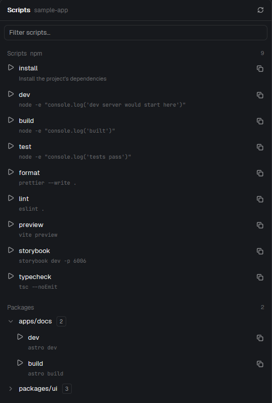

# Scripts panel for Herdr

A side panel for the [Herdr](https://herdr.dev) desktop app that lists the scripts of the project you are working in (dev, build, test, …) and runs one with a click, in a new terminal pane beside yours.



## What it adds

- **The project's scripts**, from its `package.json`, each with the command it stands for. Install, dev, start, build and test come first; the rest follow by name.
- **Click to run.** A shell opens in a pane to the right of the focused one, in the script's folder, and the command is typed into it with the project's own tool (npm, pnpm, yarn or bun). The output stays, and the shell is yours when the script ends.
- **Right-click for a choice of terminal.** Run in a new terminal, or in a shell that is already open in the space and has nothing running. Terminals running an agent or another program are never offered.
- **Workspaces**: the root's scripts first, then each package as a folded row. The package your terminal is in starts open.
- **A filter box** over every script of every package, by name or command.
- **Copy** puts the command on the clipboard instead of running it.
- It follows you: focus a terminal in another project and the panel shows that one.

It starts scripts; it does not stop or watch them. It asks for no confirmation: a script named `deploy` runs on one click like any other.

## Requirements

Node.js on `PATH`, to read the scripts. The panel says so when it is missing.

## Install

Ask your Herdr agent:

> Read ~/.config/herdr-app/AGENTS.md, then add this mod: https://github.com/cris-achiardi/herdr-mods/tree/main/scripts

It follows [RECIPE.md](RECIPE.md). Installation has two parts:

1. Copy `mods/scripts/` into `~/.config/herdr-app/mods/`.
2. **Give it a place and a button.** `mod.json` uses `"place": "none"`, so copying the folder alone shows nothing. Add a `scripts` block to your layout's `panel-body` stack and a Scripts button to your tab bar mod. RECIPE.md has both edits.

Herdr's shipped layouts and mods are read-only and restored on every start, so on a stock setup step 2 means cloning the `main` layout and the `tabs` mod and editing the clones.

### Without touching the layout

```sh
herdr-app do pane.split '{"direction":"right","mod":"scripts"}'
```

Props: `cwd` pins the pane to one folder; `filter` starts filtered.

## What it runs

- `node mods/scripts/scan.cjs <folder>` when the panel is shown and the focused folder changes, on refresh, and once a minute. It reads `package.json`, `pnpm-workspace.yaml` and the names of lockfiles, in the focused folder, its parents up to the repository's root, and the workspace's packages.
- When you click a script: the app command `terminal.open` (a new shell pane in the script's folder), `hc ls` (to find that terminal), and `hc send` (types `<tool> run <script>` or `<tool> install` and presses Enter). From the right-click menu, into a shell you chose: `hc send` only, then the app command `pane.focus`. What the script then does is the script's business.
- The clipboard, when you click Copy.

The panel itself has no network access and writes no files.

## Limits

- `package.json` scripts only. Makefiles, justfiles, Taskfiles, Cargo, Python and Deno tasks are not listed.
- Projects on other machines are not read.
- A script always runs in its own package's folder, with `run`: workspace filters (`pnpm --filter`) and extra arguments are yours to type.
- A new pane opens to the right of the focused pane; there is no choice of place.
- The menu lists at most six open shells, from the shown space only. Running in one of them types a `cd` first when that shell is in another folder.
- Built and used on Windows with Herdr 0.1.15. macOS and Linux are untested.

## License

MIT, see [LICENSE](../LICENSE). Icons are drawn after [Lucide](https://lucide.dev) (ISC, see `mods/scripts/LICENSE-lucide.txt`).
