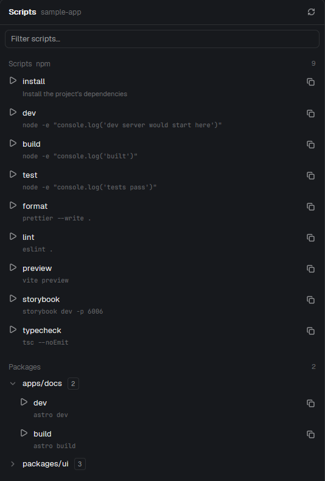

# Scripts

A side panel that lists the `package.json` scripts of the project the focused terminal is in and runs one on a click, in a new shell pane beside the focused pane. It sits in the right panel beside Files, Changes and Git, opened from a Scripts button in the tab bar.



## What you see

A card that fills its block: `background`, 1px `border`, radius 10, text 13px in `foreground`.

**Header**, 42px, 14px left padding, 9px right, 1px `border` below: "Scripts" semibold; the project's name in 12px `dim`, truncated, taking the remaining width; a 24px refresh button (13px icon in `muted`, radius 6, `hover` background and `foreground` icon on hover) whose icon spins (one turn per 900 ms) while scanning.

**Filter**, under the header with 8px side and top padding: a 30px input, radius 7, 1px `border`, 12.5px text, placeholder "Filter scripts…".

**List**, scrolling, 6px padding.

- Section heading, 30px, 8px side padding, 11.5px `dim`: a title in medium weight ("Scripts", "Packages"), a note (the package manager, for "Scripts"), and at the right a count in 10.5px (scripts; packages; `3 of 21` while filtering).
- Script row: 8px left and 4px right padding, 6px vertical, 9px gaps, radius 7, `hover` on hover, top-aligned, tooltip "Run <command line>". A 14px play icon in `muted` (a spinning refresh icon while the pane is being opened, a check in `ansi2` for 1.5 s once the command was sent); the script's name, truncated; under it its command in the terminal font, 10.5px `dim`, one line, truncated (for the added install row, "Install the project's dependencies" in 11px); a 24px copy button, a check for 1.5 s after copying. If starting failed, the second line reads "Couldn't start: <reason>" in `ansi1`.
- Package row, 30px: a 14px chevron in `dim` (right when folded, down when open), the package's path from the root (`apps/docs`), and its script count in a 10px `muted` badge with a 1px `border`. Its script rows follow when open, indented to 26px.
- While filtering: one flat list under a "Scripts" heading, each row with its package's path in 10.5px `dim` after the name; "No match" when empty.

**Row menu**: a popup at the pointer, 260px wide on `popover`, 5px padding, text 12.8px. Rows 31px high, 8px side padding, radius 7, a 14px `muted` icon, 9px gap and a truncated label: "Run in new terminal" (play icon), then one "Run in <tab name> · <folder>" (prompt icon) for each idle shell, at most six. The highlighted row is `selected`, the first one to begin with; hovered rows are `hover`. Its height is 10px plus 31px per row.

**Messages** replace the filter and list with a semibold title and one `muted` sentence: "No scripts here" (no `package.json` at or above the folder), "Not read on other machines", "Node.js not found", "Couldn't read the scripts".

## How it behaves

- Agent statuses (working, blocked, done, idle) are not shown. Only the refresh icon and a starting row's icon animate.
- The folder is the focused pane's live folder (else the focused terminal's, else the active space's), as the shipped `changes` mod finds it. Focusing a terminal elsewhere rescans within 3 s.
- It rescans when shown data is older than a minute, checked every 3 s, and on refresh. While its layout block is hidden, or is not the shown child of its stack, it runs nothing.
- Row order in a package: `install`, `dev`, `start`, `build`, `test`, then the others by name. The root package gets an `install` row that runs `<manager> install`, unless it has a script of that name.
- The root package's scripts are listed directly; every other package is a row that folds. The package the folder is in starts open, the others folded; toggled packages are kept in `localStorage` by path.
- Clicking a script row starts a new shell in that package's folder, shows it as a pane to the right of the focused pane, and types `<manager> run <name>` followed by Enter. One start at a time; further clicks are ignored until the command was sent.
- Right-clicking a script row opens the row menu. "Run in new terminal" does what a click does. "Run in …" types the command into that shell and focuses its pane; when the shell is in another folder the command is preceded by a `cd` to the package's folder (`cd "<dir>"; ` for PowerShell and POSIX shells, `cd /d "<dir>" && ` for cmd). Up/down move the highlight, Enter runs the row, Esc or a click elsewhere closes the menu.
- An idle shell is a pane of the shown space, in any of its tabs, on this computer, whose program is a shell (nothing else runs in it) and reports no agent status. Terminals running an agent or any other program are never offered.
- Copy puts that command line on the clipboard.
- Nothing is confirmed, stopped or watched, and no file is written.

## Built from

- `mods/scripts/`: `main.js`, `scan.cjs`, `mod.json` `{ "place": "none" }`, icons `play`, `terminal`, `copy`, `check`, `refresh`, `chevron-down`, `chevron-right` (drawn after Lucide) and `LICENSE-lucide.txt`.
- `main.js`: one `View` with two roles: the panel, and with `props().role === "menu"` the row menu. `herdr` functions: `spaces`, `panes`, `focused`, `exec`, `hc`, `theme`, `layout`, `settings`, `props`, `appHome`, `run`, `shared`, `setShared`, `openOverlay`, `closeOverlay`. `gpui-base`: `v_flex`, `h_flex`, `InputState` + `Input`. `cx.write_to_clipboard`, `cx.timer.every`, `cx.timer.after`. Props, all optional: `cwd` (scan this folder whatever is focused), `filter`, `unfolded` (package paths toggled from their default).
- Starting a script:
  1. Note the live terminals: `hc(["ls", "--json"])`.
  2. `run("terminal.open", { folder: <package folder>, place: "right" })`: a shell in a pane beside the focused one.
  3. Ask `hc(["ls", "--json"])` again, up to 60 times, until a live address appears that was not there: the new terminal.
  4. `hc(["send", terminal, "<manager> run <name>"])`.
- Row menu: the row's `.on_mouse_down("right", …)` stops propagation and calls `openOverlay({ mod: "scripts", kind: "popup", at: "pointer", width: 260, height: 10 + 31 * rows, props: { role: "menu", from, script: { id, name, line, dir }, targets } })`. `targets` are the idle shells at that moment: `panes()` with a `terminal`, `program.shell`, no `program.agent`, no `status`, in a tab of the active space, each as `{ pane, terminal, cwd, shell: program.key, label }`. `from` is an id the panel copy made for itself in `init`. Choosing a row calls `setShared("scripts.request", { at: Date.now(), from, script, into })` (`into` null for a new terminal) and closes the overlay. The panel reads `shared("scripts.request")` in `render` and starts a request whose `from` is its own and whose `at` is newer than the last it handled (at `init`: whatever is already there).
- Into an idle shell: `hc(["send", terminal, <cd prefix> + <command line>])`, then `run("pane.focus", { pane })`.
- `scan.cjs` (CommonJS, Node 18+, no dependencies), run as `node <appHome>/mods/scripts/scan.cjs <folder>` with a 20 s timeout, prints `null` or `{ root, name, manager, here, packages: [{ dir, rel, name, scripts: [{ name, cmd }] }] }`:
  - Walk up from the folder to the first folder holding `.git` (stopping before the home folder). The nearest `package.json` is the package the folder is in; the highest folder with a `pnpm-workspace.yaml` or a `package.json` that has `workspaces` is the root; without one the nearest package is the root. No `package.json`: `null`.
  - Workspace patterns: the `packages:` list of `pnpm-workspace.yaml`, else `workspaces` (an array, or its `packages`). `*` matches within one folder name, `**` any depth to 4; `!pattern` excludes; `node_modules`, `.git`, `dist`, `build`, `.next`, `.turbo`, `.cache` and dot folders are skipped. Packages without scripts are left out; the root comes first, the rest by path.
  - `manager`: `pnpm-lock.yaml` → pnpm, `yarn.lock` → yarn, `bun.lock` / `bun.lockb` → bun, `package-lock.json` → npm, at the root; else the root's `packageManager`; else pnpm with a `pnpm-workspace.yaml`; else npm.
  - `here` is the path from the root to the package the folder is in (`""` for the root).

**Wiring it into the window.** Shipped layouts and mods are read-only and restored on every start: if the person's layout or tab bar is shipped, clone them (`layout.clone`, `mod.clone`), point the cloned layout's `tabs` block at the cloned tab bar, and edit the clones. If the person already has their own, ask whether to change it or make a new one.

- Layout: in the `panel-body` stack of the `main` layout (0.1.15), add a child:

  ```json
  { "id": "scripts", "type": "block", "content": { "mod": "scripts" } }
  ```

- Tab bar (the `tabs` mod, 0.1.15): add `"scripts"` to `enabled` and one button after the others:

  ```js
  .child(panelButton("scripts", "Scripts", "mods/scripts/play.svg"))
  ```

- No layout change at all: `herdr-app do pane.split '{"direction":"right","mod":"scripts"}'` opens it as a pane.

## Watch out

- Copying the folder alone shows nothing. The install is not done until the person can open the panel from their tab bar, or chose the pane instead.
- Don't start the script as the terminal's own program (`pane.split { argv }`, `terminal.open { argv }`): on Windows `npm` and `pnpm` are `.cmd` shims that only a shell resolves, and the pane would close with the script, taking a build's output with it. A shell with the command typed in avoids both.
- A script runs anything, and one click runs it. Don't run a row to test the panel in someone's project; use a scratch package whose scripts only print.
- Don't start the shell with `hc run` and then show it with `terminal.keep`: from a mod the app command arrives before the app has heard of the new terminal, `terminal.keep` fails with an error toast, and the script runs in a terminal nobody can see. `terminal.open` makes the pane first.
- The menu must not start the script itself: a popup's tasks end when it closes, and opening a pane takes several awaited steps. It hands the choice to the panel through `shared`. The menu role must not start the panel's timer or scans.
- `program.shell` is true only while the shell itself is in front. A shell running a dev server reports that program instead, which is what keeps busy terminals out of the menu.
- `scan.cjs` must keep the `.cjs` extension: Herdr reads `.js` in a mod folder as a module.
- Paths from `path.relative` use backslashes on Windows; `rel` and `here` are compared and stored with forward slashes.
- Read the lockfile at the workspace root, not in the package: packages of a workspace have none.
- `.when(cond, …)` needs a real boolean.
- The block is found by `content.mod === "scripts"`: a renamed copy must update that constant and the scan's path.
- `herdr-app check` renders the first frame only (loading). To see a list: `herdr-app do pane.split '{"direction":"right","mod":"scripts","props":{"cwd":"<a project folder>"}}'`.
- Built and used on Windows with Herdr 0.1.15. Untested on macOS, Linux and remote machines, and with yarn and bun projects.

## Done when

- `herdr-app check` passes for `mods/scripts` and for the tab bar mod that was edited; `herdr-app status` shows no errors.
- The tab bar has a Scripts button; clicking it shows the panel, clicking it again hides it.
- In a project, the rows match the `scripts` of its `package.json`, with install, dev, start, build and test first, and the heading names the package manager its lockfile implies.
- In a workspace, each package with scripts is a row with its count; the one the terminal is in is open.
- Clicking a script opens a pane to the right with a shell in the package's folder and the command running in it; when the script ends the shell is still there.
- Right-clicking a script shows "Run in new terminal" and one row per open shell that sits at a prompt in this space; no agent's terminal and no terminal with a program running is listed. Choosing a shell runs the script there, with a `cd` first when the shell is elsewhere, and focuses it.
- Copy puts the same command line on the clipboard. Typing in the filter narrows the list across packages.
- In a folder with no `package.json` above it, the panel reads "No scripts here".
