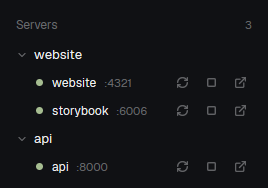

# Servers for Herdr

A sidebar section for the [Herdr](https://herdr.dev) desktop app that lists the local servers running on your computer, under the space each belongs to, with buttons to restart each one, stop it and open it in the browser.

## What it adds

- **The running servers**: every process listening on a TCP port that was started from a Herdr terminal, or that is a dev runtime (node, bun, deno, python, ruby, php, java, dotnet and a few more). Each shows its project folder's name and its port.
- **Grouped by space**: a server sits under the space whose terminal started it, or whose terminals are in its folder. The rest go under "Other". Click a space's row to fold its servers away.
- **Restart**: stops the server and runs its command again in its folder, for when hot reload gives up. The new one runs in the background as a herdr-core terminal without a pane (`hc ls` shows it).
- **Stop**: ends the server's process and the processes it started.
- **Open in browser**: opens `http://localhost:<port>`.
- Click a server to go to its space.

## Requirements

- Windows: `netstat`, `taskkill` and Windows PowerShell, all part of the system.
- macOS and Linux: `lsof` (or `ss` on Linux), `ps` and `kill`.

Nothing to install; it does not need Node.js.

## Install

Ask your Herdr agent:

> Read ~/.config/herdr-app/AGENTS.md, then add this mod: https://github.com/cris-achiardi/herdr-mods/tree/main/servers

It follows [RECIPE.md](RECIPE.md). Installation has two parts:

1. Copy `mods/servers/` into `~/.config/herdr-app/mods/`.
2. **Give it a place.** `mod.json` uses `"place": "none"`. Add a `servers` block to your layout's sidebar, under the agents list. RECIPE.md has the edit.

Herdr's shipped layouts are read-only and restored on every start, so on a stock setup step 2 means cloning the `main` layout and editing the clone.

## What it runs

Every 5 seconds while the section is on screen:

- `netstat -ano` on Windows, `lsof -nP -iTCP -sTCP:LISTEN -Fpn` elsewhere (`ss -ltnpH` without `lsof`), to list the listening ports;
- only when a process it hasn't seen starts listening, the process list: `Get-CimInstance Win32_Process` through PowerShell on Windows, `ps -A -o pid=,ppid=,args=` elsewhere; and on macOS and Linux the new process's working folder (`lsof -a -d cwd -p <pid>`, `readlink /proc/<pid>/cwd`).

When you click Stop: `taskkill /PID <pid> /T /F` on Windows, `kill <pid>` elsewhere. When you click Restart: the same, then `hc run --bg --rm --no-parent --cwd <folder> -- <the server's command>`. When you click Open, the system browser. It makes no network requests and writes no files.

## Limits

- **Stop is immediate and forced on Windows.** There is no confirmation, and the server gets no chance to clean up.
- **Restart runs the server's own command, not the script that launched it.** `npm run dev` comes back as `node …/astro.js dev`: same arguments and folder, but environment variables set by the launching script or typed before the command (`PORT=4400 pnpm dev`) are lost, and a server that was running in a terminal comes back in the background, not in that terminal.
- Restart is offered only when the server's folder is known. On macOS and Linux arguments containing spaces are not rebuilt correctly.
- A server restarted by a watcher or a process manager (nodemon, pm2, a Windows service) comes back after Stop.
- Processes whose command line contains `mcp` are left out: agents' MCP servers listen on ports too. A project of yours with `mcp` in its path is hidden with them.
- Databases and other services not started from a Herdr terminal (PostgreSQL as a service, Docker's proxy) are not listed.
- On Windows a server's folder is read off its command line (the project around `node_modules`, else the script's folder), so a server started without a path in its command (`python -m http.server`) is named after its program and lands under "Other" unless a Herdr terminal started it.
- Open always uses `http://localhost`; an HTTPS-only server needs the address fixed by hand.
- Spaces on other machines are not covered.
- Built and used on Windows with Herdr 0.1.15. macOS and Linux are untested.

## License

MIT, see [LICENSE](../LICENSE). Icons are drawn after [Lucide](https://lucide.dev) (ISC, see `mods/servers/LICENSE-lucide.txt`).
