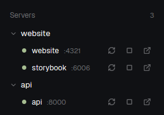

# Servers

A sidebar section that lists the local servers running on this computer under the space each belongs to. Every server has buttons that restart it, stop it, share it through a temporary public link and open it in the browser. It sits in the left sidebar under the agents list.



## What you see

A section that fills its block: `chrome` background, 1px `border` above, text 13px in `foreground`.

**Heading**, 41px (14px top, 5px bottom, 16px side padding): "Servers" in 11.5px medium `dim`, and at the right the number of servers in 11px `dim` (nothing when there are none).

**Grip**, the top 6px of the section, over the heading's padding, when the section ends its column: nothing drawn at rest; under the pointer a `selected` background and the row-resize cursor.

**Space row**, 28px, 8px side padding, 6px gaps, radius 8, `hover` on hover: a 12px chevron in `dim`, down when open and right when folded; the space's name, truncated, in `foreground`; when folded, the number of its servers in a 10px `muted` badge with a 1px `border`. Servers no space claims are under a last row named "Other", in `muted`.

**Server row**, under its open space, 28px, 26px left and 8px right padding, 7px gaps, radius 8, 12px text, `hover` on hover:

- a 7px dot in `ansi2`;
- the server's name, truncated: its folder's last part, else what it runs. Tooltip: what it runs (when not the name), the folder and `pid <n>`, joined by " · ";
- `:<port>` in 11px `dim`;
- at the right four 22px buttons with 13px icons in `dim`, `selected` background on hover: Restart (two circling arrows, `foreground` on hover, tooltip "Restart"; absent when the server's folder is unknown), Stop (a rounded square, `ansi1` on hover, tooltip "Stop"), Share (three joined dots, `accent` on hover, tooltip "Share a public link"; absent while the server is shared) and Open (an external-link arrow, `foreground` on hover, tooltip "Open in browser").

**Share row**, under a shared server, 26px, 45px left and 8px right padding, 6px gaps, radius 8, 11px text: a 12px link icon in `accent`; the public address without `https://`, truncated, in `muted`; a 22px ✕ button, tooltip "Stop sharing". `hover` on hover, tooltip "Public link: anyone who has it can see this server. Click to copy." While the tunnel starts: a 12px spinner and "Creating link…" in `dim`.

While a server is being stopped or restarted its row is `dim`, the dot is a 12px spinner turning once per 900 ms, and the buttons are gone.

**Messages** replace the rows, a `muted` 12px title and an 11px `dim` sentence: "No servers running" / "A dev server shows here once it listens on a port."; "Couldn't list the servers" with the error's first 160 characters.

## How it behaves

- A server is a process listening on a TCP port that has `herdr-core` among its ancestors, or whose program is one of node, nodejs, bun, deno, python, pythonw, py, ruby, php, java, dotnet, hugo, uvicorn, gunicorn, puma, caddy. Processes with `mcp` in their command line, and Herdr's own, are left out. A process listening on two ports gets a row for each.
- A server belongs to, in this order: the space of the terminal whose process is one of its ancestors; the space with a terminal whose folder contains the server's folder or is inside it (the deepest such terminal folder; terminals at the home folder don't count); the space whose name is one of the parts of the server's folder. Otherwise "Other". Spaces keep their order; spaces on other machines are skipped.
- Clicking a space row folds or unfolds its servers. Folded spaces are kept in `localStorage` by space id.
- Clicking a server row focuses the pane that started it when known, else selects its space. Rows under "Other" do nothing.
- Stop ends the process and its children at once, with no confirmation, then reloads the list; the row goes when the port closes. If the program refuses, an error toast says so and the row comes back.
- Restart ends the process and its children, waits until nothing listens on the port (at most 20 looks), then starts the server's command line again in its folder as a herdr-core terminal with no pane and no parent, removed when it exits. The new server shows on the next reload. A failure at any step is an error toast.
- Share starts a Cloudflare quick tunnel to the server's port as a herdr-core terminal named `share-<port>`, with no pane and no parent. The share row shows at once with "Creating link…"; on a following reload the address is read off the terminal, copied to the clipboard and announced in a success toast "Public link copied". Clicking the share row copies it again, with the same toast. A missing `cloudflared` is an error toast with the install commands.
- A server is shared when a live terminal named `share-<port>` exists, whoever started it; nothing else is stored, so shares survive a restart of the app.
- Stop sharing (✕) ends that terminal. Stop on the server ends it too. Restart keeps it. A share whose port has had no listed server for three reloads in a row is ended.
- Open opens `http://localhost:<port>` in the system browser.
- It reloads every 5 s while its layout block is shown; a hidden block runs nothing.
- The block resizes itself with `layout.resize` to the height of its content with every space unfolded, up to 300px, then scrolls. Folding a space leaves the block's size unchanged. It does so once the first list has loaded, not before.
- Dragging the grip sets the block's height with `layout.resize`, following the pointer: up is taller, down is shorter, never under 41px (the heading) and with no upper limit of the mod's own (the 300px limit is for the fitted height only). The grip is drawn only when the block is the last shown child of a `column`: Herdr's divider above it resizes the block above, never this one.
- A height set with the grip stops the fitting: the block keeps it whatever is listed, scrolling when the rows don't fit, and across restarts (Herdr keeps the size in `layouts/.state/`; the mod keeps `fit` in `localStorage`: `[height it last asked for or saw, whether the person's height is kept, the height it replaced until the asked one is seen, then the same as the first]`, written whenever one of them changes). So does a height Herdr's own divider gave the block, in a layout where one reaches it.
- A double-click on the grip or on the heading makes the block fit itself again. There is no other way back: a height near the content's is kept like any other.
- Agent statuses (working, blocked, done, idle) are not shown.

## Built from

- `mods/servers/`: `main.js`, `scan.js`, `mod.json` `{ "place": "none", "title": "Servers" }`, icons `restart`, `stop`, `share`, `link`, `x`, `external`, `spinner`, `chevron-down`, `chevron-right` (drawn after Lucide) and `LICENSE-lucide.txt`.
- `main.js`: one `View`. `herdr` functions: `spaces`, `panes`, `terminals`, `exec`, `hc`, `theme`, `layout`, `props`, `home`, `window`, `run`, `notify`. Commands: `pane.focus {pane}`, `space.select {id}`, `layout.resize {id, px}`. `cx.open_url`, `cx.write_to_clipboard`, `cx.timer.every`. From `gpui-base`, for the grip: `SliderState`, `Slider`, `SliderTrack`, `SliderIndicator`, `SliderThumb`. `props { demo: true }` draws two sample spaces at 268px wide and runs nothing; `folded: ["b"]` starts the second one folded.
- `scan.js` exports `scan(exec, platform, cache)`, which resolves with `[{ port, pid, proc, cmd, dir, tool, name, herdr, ancestors }]` sorted by port. `platform` is `window().platform`; `cache` is a `Map` the view keeps.
  1. Listeners. Windows: `netstat -ano`, rows matching `TCP <local>:<port> (0.0.0.0|[::]):0 <state> <pid>`. Elsewhere: `lsof -nP -iTCP -sTCP:LISTEN -Fpn` (`p` lines give the pid, `n` lines end in the port), or `ss -ltnpH` when `lsof` can't run. Deduplicated by pid and port.
  2. Cache entries of pids no longer listening are dropped. If a listening pid is not cached, the process table is read once: Windows `powershell -NoProfile -NonInteractive -Command "[Console]::OutputEncoding=[Text.Encoding]::UTF8; Get-CimInstance Win32_Process | Select-Object ProcessId,ParentProcessId,Name,CommandLine | ConvertTo-Json -Compress"` (30 s); elsewhere `ps -A -o pid=,ppid=,args=`.
  3. Each new pid: its ancestors' pids and names; `herdr` if one is `herdr-core` or `hc`; shown or not by the rule above, and cached either way.
  4. `dir`: Linux `readlink /proc/<pid>/cwd`; macOS `lsof -a -d cwd -p <pid> -Fn`; Windows the first argument that is an absolute path, cut before `node_modules`, else without its last part.
  5. `tool`: the name after `node_modules/.bin/` (through a `..` if there is one), else the package after `node_modules/`, else the first argument that is not an option without its extension, else the program. `name`: the last part of `dir`, else `tool`.
- Stop: `taskkill /PID <pid> /T /F` on Windows, `kill <pid>` elsewhere, through `exec`.
- Restart: the same, then `scan.js`'s `listeners(exec, platform)` until the port is absent, then `hc(["run", "--json", "--bg", "--rm", "--no-parent", "--cwd", dir, "--", ...argv(cmd)])`. `argv` (from `scan.js`) splits the command line on spaces, keeping double-quoted parts whole.

- Share: the program is the first of `cloudflared`, then `C:Program Files (x86)cloudflaredcloudflared.exe` and `C:Program Filescloudflaredcloudflared.exe` on Windows or `/opt/homebrew/bin/cloudflared` and `/usr/local/bin/cloudflared` elsewhere, that runs `--version` with code 0. Then `hc(["run", "--json", "--bg", "--rm", "--no-parent", "--name", "share-<port>", "--", program, "tunnel", "--url", "http://localhost:<port>", "--http-host-header", "localhost"])`. Shares: `terminals()` entries whose `name` matches `share-<digits>` and whose `state` is `live`. Address: the first `https://[a-z0-9-]+.trycloudflare.com` in `hc read <address> --lines 200`, kept in memory per terminal address. End: `hc kill <address>`.
- `scan.js` leaves out processes named `cloudflared`: the tunnel listens on a local metrics port.

**Wiring it into the window.** Shipped layouts are read-only and restored on every start: if the person's layout is shipped, clone it (`layout.clone`) and edit the clone. In the sidebar's lists column (`sidebar-lists` in the `main` layout, 0.1.15), after the agents block:

```json
{ "id": "servers", "type": "block", "content": { "mod": "servers" }, "size": { "px": 97 } }
```

Without a layout change: `herdr-app do pane.split '{"direction":"right","mod":"servers"}'` opens it as a pane.

## Watch out

- Copying the folder alone shows nothing; the install is done when the section is in the sidebar.
- Don't match `netstat`'s state word: Windows translates it. A listening row is the one whose remote address is `0.0.0.0:0` or `[::]:0`.
- Servers an agent starts in the background are usually orphans: their parent shell has exited, so the chain of ancestors stops before any terminal. That is why the folder and the space's name are tried after the ancestors, and why dev runtimes are listed without a Herdr ancestor.
- Starting PowerShell takes about half a second; reading the process table on every reload would keep a core busy. Read it only for an unseen listening pid, and cache the pids that are not shown too.
- Windows gives no working folder for another process; the command line is the only source. `node_modules\.bin\\..\astro\astro.js` has a doubled separator: match runs of separators.
- Start the restarted server only once the port is free: Astro and Vite take the next port when theirs is busy.
- Restart re-runs the listening process's command line, not the `npm`/`pnpm` script above it: the environment that script set, and variables typed before the command, are not carried over. `ps` drops quoting, so off Windows arguments with spaces split.
- cloudflared prints the address a few seconds after it starts, and a mod can't sleep: read it on the reloads that follow, not in a loop.
- A Herdr that was running when cloudflared was installed doesn't have it on `PATH` yet; that is why the install folders are tried.
- Without `--http-host-header localhost`, Vite and Astro dev servers answer the tunnel's host name with "Blocked request".
- `--name` must be unique among live terminals: a second Share for the same port is refused by herdr-core, so check `shares()` first.
- A terminal at the home folder contains every project: skip it when matching by folder.
- `scan.js` takes `exec` as an argument so it can be run outside Herdr with a `child_process` stand-in; keep it free of `herdr` imports.
- The block is found by `content.mod === "servers"`; a renamed copy must update that constant.
- `layout.resize` only works on a personal layout. In a shipped one the block keeps the size the layout gives it.
- `on_mouse_move` reaches an element only while the pointer is over it, and a pointer dragged up leaves the block at once, so press/move/release on a `div` drops the drag. The grip is a vertical slider instead (`SliderState` 0 to 4000 in steps of 1): gpui-base's track starts a GPUI drag, whose moves arrive wherever the pointer is. The `Slider` covers the section (`absolute`, `inset_0`; it takes no press itself, the rows under it still do); its `SliderTrack` is the top 6px and carries the cursor and the hover; its `SliderIndicator`, a sibling of the track, is a box 4000px tall hanging up from the section's bottom edge (`absolute`, `bottom_0`, `h(4000)`), with a `SliderThumb` sized 0 inside. The value is the pointer's distance above that bottom edge, 0 under it.
- The height asked for is the block's `size.px` at the press plus the value's change since the first value of the drag, the way Herdr's own dividers measure (from the pointer's position against an edge that stays put, never from what was last drawn). The first `change` of a drag is the press itself: the track reports it before any move. Don't read sizes back during the drag: `run` is queued, so `layout()` and the drawn height trail the pointer by a varying number of events, and `on_size_change` and mouse positions are in screen px, which are layout px times the person's zoom (`settings.json` `zoom`), while the slider's value is in layout px (its box is drawn zoomed, its range is not). Adding a drawn height to a slider distance drifts by the zoom's excess: at zoom 1.1 the edge runs 10% ahead of the pointer.
- Every `layout.resize` runs Herdr's whole sync: the layout is published to every mod, `layouts/.state/` is written, the window is redrawn. Ask only when the whole-px height changed. Herdr's dividers publish and write once, on release; a mod has no way to resize without both.
- Two `release` events with no resize between them within 400 ms are the grip's double-click (a slider track takes no `on_mouse_down` from the script). The heading takes `on_mouse_down` and reads `click_count`.
- The grip assumes the block's bottom edge stays put, which is why it is drawn only at the end of a column.
- A drag by Herdr's own divider is told from the mod's resize by the block's `size.px` in `layout()`: it is a drag when it is neither the height the mod last asked for nor the one that was there before it asked (`layout()` can still show that one on the next render, and always does in a shipped layout). Once the asked height is seen, the one before it is no longer excused; with nothing stored, the first height seen is the baseline. There is no resize event. A layout that stored another height than the one asked for (a clamp) would read as a drag.
- Built and used on Windows (Spanish locale) with Herdr 0.1.15. The macOS and Linux branches are untested.

## Done when

- `herdr-app check` passes for `mods/servers`; `herdr-app status` shows no errors.
- With no dev server running the section says "No servers running".
- After `node -e "require('http').createServer((q,r)=>r.end('ok')).listen(4999)"` in a Herdr terminal, a row with `:4999` shows within 5 s under that terminal's space, and the heading's number goes up by one.
- Its Open button opens `http://localhost:4999` in the browser.
- Its Restart button brings the row back on the same port with a new pid, and `hc ls` lists the new terminal.
- Its Share button shows "Creating link…", then within about 10 s an address that is on the clipboard and that serves the page from another network; `hc ls` lists `share-4999`, and no `cloudflared` row appears in the section.
- The share row's ✕ ends that terminal and the address stops answering.
- Its Stop button ends that process; the row is gone within 5 s and the port is free.
- A server started in the background by an agent shows under the space working in its folder.
- Clicking a space row hides its server rows and shows their count; clicking again shows them; the choice survives a restart.
- With the section last in its sidebar column, the pointer over its top edge turns into the row-resize cursor; a press there dragged up, fast and well past the edge, grows the section under the pointer, dragged down shrinks it to no less than its heading; the height stays when servers start or stop and after a restart; a double-click on the edge or the heading fits the section to its list again.
