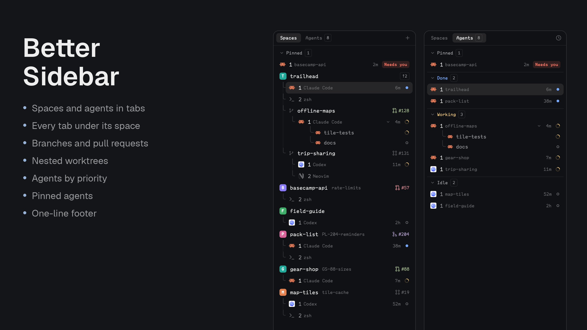
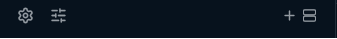

# Sidebar Plus

> **Fork.** Sidebar Plus is a modified copy of [Better Sidebar](https://github.com/munza/herdr-mods/tree/main/better-sidebar) 3.10.0 by Tawsif Aqib ([munza/herdr-mods](https://github.com/munza/herdr-mods), commit `bad7512`), licensed under the Apache License 2.0. The original's [LICENSE](LICENSE) and attribution ([NOTICE](NOTICE)) are kept in this folder. What this copy changes is listed under [Changes from Better Sidebar](#changes-from-better-sidebar); the rest of this page is the original's, with the name changed.

A spaces sidebar for Herdr Desktop that shows each space's Git branch beside its name, nests worktrees under their main checkout, and shows each space's pull request coloured by its state, from the GitHub CLI. The same mod also draws an agents list with more ways to group them, a one-line footer and a right panel toggle.




## Quick start

1. Install with the prompt below. It takes the place of your spaces list.
2. Each space shows its branch beside its name and its PR at the right of the row. Cmd-click the PR number to open it on GitHub.
3. Click the icon beside **Agents** to group agents by space, main space or name prefix.

## Install

Copy this prompt into your Herdr agent:

> Read ~/.config/herdr-app/AGENTS.md, then add this mod: https://github.com/cris-achiardi/herdr-mods/tree/main/sidebar-plus

Installation follows [RECIPE.md](RECIPE.md). The agent tells you that the mod runs Git and `gh` and reaches GitHub with your local login, then copies only `mods/sidebar-plus/` into the app configuration. The manifest uses `"place": "none"`: the installer should **replace the existing spaces block's mod reference**, not add a second sidebar. Herdr's shipped layouts (`main`, `terminals`, `win98`) are read-only and restored on every start, so the mod only shows in a layout you own. If you are on a shipped layout, your agent clones it and edits the clone; if you already have your own layout, it asks whether to add the mod there or create a new layout. Preserve the agents list, other panels, key bindings, and the existing layout's dimensions. Never overwrite an unrelated mod on a name clash.

The spaces block should reference `"mod": "sidebar-plus"`, the agents block `{ "mod": "sidebar-plus", "props": { "view": "agents" } }`, and the footer block `{ "mod": "sidebar-plus", "props": { "view": "footer" } }` with its height set to 37px. Each is optional. Keep its existing ID, size, and other properties. Leave the previous mod installed if other layouts still use it; restoring that reference rolls back the change.

The right panel toggle is its own block, so it needs the layout to hold the tab bar and this block in a row:

```json
{ "id": "tabs-row", "type": "row", "size": { "px": 42 }, "children": [
  { "id": "tabs", "type": "block", "window_drag": true, "content": { "mod": "better-tabs" } },
  { "id": "panel-toggle", "type": "block", "size": { "px": 36 }, "content": { "mod": "sidebar-plus", "props": { "view": "panel-toggle" } } }
] }
```

`props.target` names another layout node to toggle; the default is `panel`. The included `keys.json` binds **Cmd+Shift+B** on macOS to `sidebar-plus.toggle-panel`; merge it into `~/.config/herdr-app/keys.json`. The command only works while this block is in the layout.

### Requirements and access

- Git on every machine whose spaces you use.
- A local installation of [GitHub CLI](https://cli.github.com/), authenticated with `gh auth login`, with access to the repositories you want to show.
- Herdr 0.1.16 or newer, for its mod APIs; no Node.js runtime dependency.

The mod runs read-only Git commands in space directories and calls `gh pr list` / `gh pr view`, which contact GitHub using your local credentials. **Remote Git reads run on the space's machine; GitHub queries run locally.** It never stages, commits, checks out branches, creates PRs, or changes Git configuration. The Git reads only look at refs, so they don't scan the worktree and don't wake the index.

## Use

Cmd-click a PR number to open it on GitHub.

- The current branch sits **beside the space name**, small and dim, except `main`, `master` and a branch that repeats the name, which go without saying. The selected space also shows how far it is ahead of or behind its remote.
- Worktree spaces nest beneath an open space for the same repository. Each worktree keeps its own branch and PR status. Herdr's own order is kept that way too, so the number keys pick the space the row shows.
- The checkout's PR sits at the **right of the same row**, as an icon and number, coloured **green Open**, **gray Draft**, **purple Merged**, **red Closed**, **red Conflicts**, **red Checks failed**, **yellow Changes requested**, or **green Ready to merge** with a ✓ after the number. The tooltip says which. GitHub works out conflicts and mergeability on its first ask, so a new PR can show Open for up to a minute before its real state. Colors follow the current theme.
- **Cmd-click the PR number** to open its GitHub URL (Ctrl-click on Linux/Windows). A normal click still selects the space. Hover a PR for its repository, title, and status. If there are several open PRs, the newest is shown with a `+N` summary; hover that summary for the others.
- Preserves space selection, right-click menus, drag reordering within a machine, the plus that creates a space, colored avatars, ahead/behind counts, machine groups with fold, and the compact rail when the sidebar is narrower than 160px.
- A machine that was rebuilt or replaced shows **rebuilt ·** with **Connect**, which connects to the core that answers there now. A machine waiting for a password shows the `hc machine login` command to run, with a **Copy** button. A machine whose agents stop when you disconnect shows a **⚠** that opens Herdr's Add machine window.
- When you switch spaces from the keyboard, the list scrolls that space and its tabs into view, as little as it can. A click in the list never scrolls it.
- **Sort spaces** from the icon beside the plus: **Manual** is Herdr's own order, the one you drag; **Recent** puts the space where something last changed first; **Name** sorts A to Z. A worktree stays under its main space, which sorts by the latest change in either. Dragging works only in Manual. The choice is remembered.
- The number keys follow Herdr's own order, with the worktrees under their main checkout, as Herdr's sidebar does. They do not follow **Recent** or **Name**, where the list shows another order; use the agent keys, which do follow the list.

A space's branch and PR describe its **first terminal's live directory**, falling back to the space's folder—matching Herdr's space naming and worktree grouping. Switching to a different terminal tab does not change that rule.

### Agents

The agents block is adapted from Herdr's shipped panel and keeps its pins, sub-agents, status and fold behaviour. The icon beside **Agents** chooses how they are gathered:

- **Priority** and **Grouped by space**, as in Herdr.
- **Grouped by main space** puts a worktree's agents with its main checkout's, under the main space's name. A worktree whose main space is not open groups under the repository's folder name. It needs the spaces block of this mod in the same layout; without it each space is its own group.
- **Grouped by prefix** gathers names like `PR-12`, `INS-4` and `PLAT-work`, also after a folder as in `feature/INS-4`. It reads the worktree or space name first, then the tab name. Capitals need only the dash, lower case needs a number after it, so `pr-12` counts and `herdr-mods` does not. Everything else goes under **No prefix**, last.

Pinning an agent asks Herdr to keep the pin with the agent's terminal, so the pin shows in every Herdr window and on the phone, and ends with the agent. A sub-agent that has a pane of its own shows once, under its parent.

**Figma files** (Sidebar Plus). With this repository's [Figma Bridge](../figma-bridge/) installed, each agent lists the Figma files its Claude Code session last worked on, under its row and before its sub-agents; a sub-agent's files hang under the sub-agent. A file row shows the file name and page; while the agent is calling Figma, the figma-console tool it runs and a spinner, afterwards how long ago. Click it to open the file. Folding an agent folds its files too. The same rows show under agents in the combined Spaces list. Without Figma Bridge, or when it stops reporting for a minute, there are no file rows. The Figma section itself can be switched off: the agents view keeps Figma Bridge probing while it listens.

### Spaces and agents in one block

A block with `"props": { "view": "lists" }` shows both lists, under two tabs:

- **Spaces:** the spaces list, with each space's tabs beneath it in order, joined by tree lines: each row is its tab's title as Herdr's tab bar shows it, then its program quietly beside it, like `1 Claude Code` or `2 zsh`. Clicking one opens it. Pinned agents sit in a Pinned group above every space. Next-agent keys follow the same order.
- **Agents:** the agents list, with its grouping menu at the right of the tabs. Each row reads its tab's title, then its space quietly beside it, like `1 herdr-mods`; the icon says which agent it is.

**Servers** (Sidebar Plus). With this repository's [Servers](../servers/) mod installed, the Spaces tab lists each space's local servers after its tabs and agents, on the same tree line: a server icon, its name and `:port`. Click one to open it in the browser. On hover it shows Restart (when its folder and command are known), Stop, Share a public link (or, once shared, Copy the public link and Stop sharing) and Open; Servers does the work, as with its own buttons. A shared server shows a link mark. Servers no space claims are listed last, under **Other servers**. Without Servers, or when it stops reporting for a minute, there are no server rows. The Servers section itself can be switched off: this view keeps Servers scanning while it listens.

**Folding** (Sidebar Plus). In the Spaces tab, a space with anything under it ends its row with a small chevron: click it to fold the space's tabs, agents and servers away. Folded, it shows how many rows are hidden, coloured by the most urgent agent among them (blocked, done, then working), and the choice is kept across restarts. Next-agent keys still reach a folded space's agents. An agent folds whatever hangs under it, Figma files included, not only sub-agents; folded, its count includes them.

The Agents tab shows how many agents there are. For the ones that need you first, sort Agents by priority. The tab you pick is remembered. On the narrow rail, the two lists sit one above the other.

Turn `combined` off in the settings for spaces above agents in the same block, without tabs, as two separate blocks would show them. The `spaces` and `agents` views still work on their own, for a layout that wants them in blocks of their own.

### Footer

Settings and Add machine sit on one line as icons, with their names in tooltips. Settings shows a dot when an update is ready. With [Better Config](https://github.com/munza/herdr-mods/tree/main/better-config/README.md) installed, a Mod settings icon after Settings opens it.



The full-window demo above predates this footer alignment.

### Right panel toggle

The panel icon at the far right of the tab bar hides or shows the right panel without changing its selected view. It is dim while the panel is hidden. **Cmd+Shift+B** does the same once you merge `keys.json` (see Install).

### PR discovery and limits

GitHub.com HTTPS and SSH remotes are supported. GitLab, other hosts, and GitHub Enterprise hosts are not currently supported. Detached HEADs, non-Git folders, and branches with no matching PR show none.

The mod checks the current branch against the checkout's GitHub remotes. It ignores same-named branches from unrelated forks, prefers open PRs, and otherwise shows the most recently updated closed/merged PR. Discovery examines at most 100 PRs per repository and branch.

An existing `branch.<branch>.herdr-pr` Git setting such as `owner/repo#42` overrides automatic discovery. The mod only reads that setting; it does not create it.

PR results refresh at most once a minute per checkout, with immediate lookups when Herdr reports a branch change. Successful identical GitHub queries are cached for one minute. Local Git changes also trigger refreshes through Git-directory watches; remote/external changes have a 15-second foreground fallback. An API or authentication failure preserves last-good PRs **only for the same branch**, marks them stale, and exposes the error on hover. Without a previous result, the line reads `PR unavailable`. New branch selections never inherit an old branch's PR.

The PR badge has no merge or review controls. Selecting its row selects the space; Cmd-clicking the number opens the PR in your default browser. Space menus continue to use Herdr's shipped `menu` mod. Worktree grouping is for **open spaces**, not every checkout on disk. A worktree without an open main-checkout space remains a top-level row.

## Settings

[Better Config](https://github.com/munza/herdr-mods/tree/main/better-config/README.md) shows these with what each one does, and changes, checks and resets them for you. By hand, add a `settings` block to the installed `~/.config/herdr-app/mods/sidebar-plus/mod.json` with only what you change, such as `"settings": { "combined": false }`. `mod.schema.json` beside it describes every setting, so an editor that reads `$schema`, such as VS Code or Zed, checks the block as you type. Problems with the block are logged, not shown.

| Key | Default | What it does |
| --- | --- | --- |
| `git.retry_after` | `15s` | How long a failed Git read waits before it's tried again. |
| `combined` | `true` | Show the `lists` view as Spaces and Agents tabs. `false` stacks spaces above agents in the same block. |
| `pull_request_status` | `true` | Colour spaces by their PR's state through the GitHub CLI. Set `false` if you don't have `gh`. |
| `agent_name` | `tab` | What each agent row is called: `tab` for its tab's name, `title` for the terminal's live title, which agents set to what they're doing. Either falls back to the other. |

## Update

To update by hand, copy `mods/sidebar-plus/` into `~/.config/herdr-app/mods/`; this replaces `mod.json`, so carry your `settings` block forward, or let [Better Config](https://github.com/munza/herdr-mods/tree/main/better-config/README.md) restore it. The `sync.sh` script preserves installed settings when it copies the mod.

## For developers

One mod draws five blocks. `props.view` picks which:

| `props.view` | Other props | What it draws |
| --- | --- | --- |
| (none) | None | The spaces list. This is the default. |
| `lists` | None | Spaces and agents in one block, under Spaces and Agents tabs (or stacked with `combined` off). Estro uses this. |
| `agents` | None | The agents list with its grouping choices. |
| `footer` | None | The one-line footer. Give its block a 37px height. |
| `panel-toggle` | `target`: the layout node to toggle, default `panel` | A 36px button that runs `layout.toggle` on the target. |

Command: `sidebar-plus.toggle-panel` toggles the target, only while a `panel-toggle` block is in the layout.

The spaces view publishes `sidebar-plus.space-parents` in shared state from its Git data; the agents view reads it for Grouped by main space.

### Work on the mod

In `mods/sidebar-plus/`:

- `main.js`: picks the part a block draws, from `view` in its props. `settings.js`: shared with the other mods.
- `git/checkouts.js`: reading a space's checkout. `git/pr-status.js`: GitHub discovery, PR appearance, caching, and stale-result handling.
- `views/spaces.js`, `views/agents.js`, `views/footer.js`, `views/panel-toggle.js`: the parts. `views/ui.js`: the design kit, Herdr's sizes and small components, with only what this mod uses.
- `icons/`: this mod's icons.
- `sync.sh`: copies the mod into Herdr, which reloads it. A symlink loads the code but not the icons. It keeps the `settings` block of the installed `mod.json`, so your settings survive a sync.
- `tests/spaces.test.cjs`, `tests/agents.test.cjs` and `tests/lists.test.cjs`: isolated Herdr/GPUI stand-ins for discovery, polling, races, grouping, rendering, and packaging.

```sh
node --test tests/*.test.cjs
herdr-app check "$PWD/mods/sidebar-plus"
```

Apache License 2.0: see this folder's [LICENSE](LICENSE) and [NOTICE](NOTICE). This folder is not covered by the repository's MIT license.

## Changes from Better Sidebar

Based on Better Sidebar 3.10.0 ([bad7512](https://github.com/munza/herdr-mods/tree/bad7512b6148b7092068cd3a6478c45706731c18/better-sidebar)).

- **Name.** Folder, asset paths, settings file, shared key (`sidebar-plus.space-parents`), element ids and the `toggle-panel` command are `sidebar-plus`, so it installs beside Better Sidebar and an update of either never overwrites the other.
- **Space menu.** A right-click on a space row, or on the empty part of the list, opens this repository's [Space Menu](../space-menu/) (`space-menu` mod, `{ space }` props, at the pointer) instead of Herdr's shipped `menu`. Needs `space-menu` installed.
- **Pull requests from `gh pr list`.** `gh` can leave `headRepository.nameWithOwner` empty in `pr list` output, which dropped the space's own PR as an unrelated fork. The query also asks for `headRepositoryOwner`, and the head is matched as `owner/name` when `nameWithOwner` is missing.
- **Figma files under agents.** The agents view (and the combined lists) draws an agent's Figma files, read from Figma Bridge's shared `figma.agents`, before its sub-agents, each sub-agent with its own; tree lines as for sub-agents; a click opens the file. It marks shared `figma.listen` on start and every 30 s so Figma Bridge keeps probing while its section is hidden. `icons/figma.svg` is Lucide's (ISC, `icons/LICENSE-lucide.txt`).
- **Servers under spaces.** The lists view's Spaces tab draws each space's servers after its tabs and agents, and unclaimed servers under "Other servers" (a new `below` hook in the spaces view, after every space). Rows and buttons are in `views/servers.js`; data from the Servers mod's shared `servers.spaces`; buttons write shared `servers.request` for it to run. Marks `servers.listen` on start and every 30 s. Icons `restart`, `stop`, `share`, `link`, `x`, `external` are Lucide's (ISC).
- **Folding.** In the lists view a space row ends with a fold button (a new `fold` hook at the end of the spaces view's row title) when it has rows under it; folded spaces are kept in `localStorage` (`lists.folded-spaces`) and drawn without their rows, with a count coloured by the most urgent agent. An agent's fold button shows when anything hangs under it (Figma files too) and counts all of it.
- **Tests.** The spaces test expects the `space-menu` overlay; four agents tests cover the Figma rows; four lists tests cover the server rows, one the space fold, one agents test the fold of Figma-only agents (the lists harness keeps `setShared` values to read requests back); the test loaders accept CRLF, as a Windows checkout with `core.autocrlf` has.

