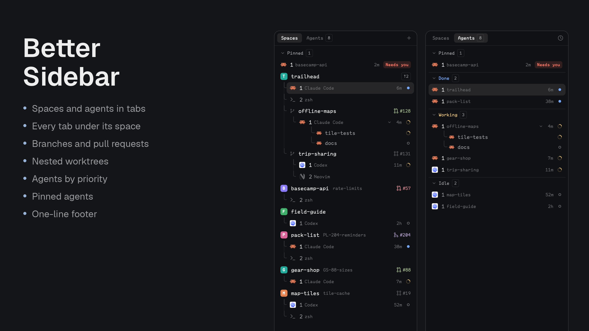

# Sidebar Plus

> **Fork.** Sidebar Plus is a modified copy of [Better Sidebar](https://github.com/munza/herdr-mods/tree/main/better-sidebar) 3.10.0 by Tawsif Aqib ([munza/herdr-mods](https://github.com/munza/herdr-mods), commit `bad7512`), licensed under the Apache License 2.0. The original's [LICENSE](LICENSE) and attribution ([NOTICE](NOTICE)) are kept in this folder. What this copy changes is listed under [Changes from Better Sidebar](README.md#changes-from-better-sidebar); the rest of this recipe is the original's, with the name changed.

A replacement spaces sidebar for a person's existing Herdr layout. It requires Herdr Desktop 0.1.16 or newer. Each space name has its current Git branch quietly beside it and the checkout's pull request at the right, with a state-specific icon, number, and color, queried through the local GitHub CLI. Worktree spaces nest under their repository's main-checkout space.

## What you see

A full-height theme-chrome sidebar with a 31px header labeled Spaces and a plus button. The body scrolls vertically. Main space rows are 30px high; nested worktrees are 28px. A row with PR status gets 22px extra height. Active rows use the theme's selected background; other rows highlight on hover.

Main rows have an 18px rounded colored initial avatar, a truncating space name, then the branch in caption size and `dim`, filling and truncating, then at the right the pull request and the ahead/behind badges. Hide the branch when it is main, master or the same as the name. Show detached for detached HEAD. The selected space also shows ahead and behind as badges, like `↑2`. Worktrees indent 22px with a branch icon instead of an avatar. Keep name, branch and PR on the same line and make long text truncate rather than widening the sidebar.

The PR sits at the right of the name row. Show the newest matching open PR as its icon and number, `#42`, with its state in the color and the tooltip. Open is theme ansi2 green; draft is dim gray with a draft icon; merged is ansi5 purple with a merged icon; closed is ansi1 red with a closed icon. For an open non-draft PR, in this order: `mergeStateStatus` DIRTY is ansi1 red Conflicts; failed/error/timed-out/action-required/startup-failure checks are ansi1 red Checks failed; `reviewDecision` CHANGES_REQUESTED is ansi3 yellow Changes requested; `mergeStateStatus` CLEAN with an APPROVED or empty `reviewDecision` is ansi2 green Ready to merge, with ` ✓` after the number. GitHub answers UNKNOWN until it has computed the merge state, which reads as Open. Keep Draft in the tooltip. Other statuses keep their labels. Terminal PR states take precedence over draft/check flags. A +N summary represents additional open matches. Tooltips identify repository, number, title, and state. Only when the lookup fails does a line beneath the name, indented 27px for main rows and 44px for worktrees, say "PR may be stale" or "PR unavailable".

When other machines are known, add a 26px machine header with a monitor/server icon, connection indication, fold control, and new-space button. A rebuilt machine offers **Connect**; a machine needing login shows the `hc machine login` command with **Copy**; and a machine whose agents stop at logout shows a warning that opens Add machine. A mod narrower than 160px becomes a compact rail of space numbers and a PR icon, or the existing attention glyph when no PR exists. Use the element's actual size, not an assumed layout node name.

## How it behaves

Click a row to select its space. Cmd-click the PR number on macOS (Ctrl-click on Linux/Windows) to open its GitHub URL in the default browser using the event context's open_url. Plain clicks on the number still select the space. Stop propagation of modified mouse-down, mouse-up, and click events so the enclosing row neither starts a drag nor changes selection when opening a link. Right-click on a row, or on the empty part of the list, opens the `space-menu` mod (this repository's Space Menu) as a popup at the pointer; the row's right-press stops propagation so the list's own right-press doesn't open it twice. Drag rows to reorder within a machine, never across machines. A sort menu (`Menu` with Lucide `grip-vertical`, `clock` and `arrow-down-a-z`) sits before the plus, in the header and on the lists view's Spaces tab: Manual is Herdr's order; Recent orders by when a space's tabs last changed status, newest first: stamp each tab's status change yourself, counting done and idle as one so looking at a finished space doesn't move it, keep the stamps in `localStorage` ("spaces.changed", dropping gone tabs after 30 days) so the order survives a restart, and seed a tab seen for the first time from its `changed_at` or `working_since` (0 when neither); Name by `localeCompare` with base sensitivity. A main space and its worktrees move as one group, by the main's name or the group's latest change, the worktrees still under it; ties keep Herdr's order. The choice is `shared("spaces.sort")`. Sorted, a drag never starts, so a press only selects, the pressed row doesn't fade, and the order holds still until the button is released. Each space and the rows under it (its tabs and agents) are one child of the list. The list's `ScrollHandle`, attached with `track_scroll`, brings the shown space's child into view with `scroll_to_item` once each time the shown space changes, as from a key; the index counts every child above it (pinned agents, machine headers, other spaces). The host scrolls as little as it can, so a space above lands with its row at the top and one below with its last row at the bottom; a space taller than the list that is below the fold still lands with its last row at the bottom and its own row hidden. A change within a second of a press in the list doesn't scroll, so a clicked row stays under the pointer. A space that isn't listed, as in a folded machine, waits until it is, and switching away and back scrolls again. Plus creates a space; machine plus creates one there. Store folded machine state locally. Share only the existing `space.colors` avatar preferences with Herdr's menus. Do not write shared state from render.

Use the first terminal's live cwd for each space, falling back to its stored folder. Resolve the Git common directory to associate worktree spaces with an open main-checkout space on the same machine; an orphan worktree remains top-level. Newly appearing spaces wait briefly for metadata to avoid jumping between positions.

Read only Git ref metadata with `rev-parse`, `symbolic-ref`, and `rev-list`; do not run `git status`, which scans the worktree. Give each Git command a 10-second timeout and read at most six spaces at once. Watch local Git directories and refresh after terminal/agent work finishes or a remote machine reconnects; poll foreground metadata on a 15-second fallback. Detect branch changes from live pane facts. Never alter the repository.

For PR status, read the symbolic branch and any explicit `branch.<branch>.herdr-pr` association. If present, query that repository/number. Otherwise read GitHub.com remotes and query up to 100 PRs per repository for the branch. Match the exact head branch and reject unrelated fork heads. Deduplicate matches, prefer current open PRs, otherwise choose the latest updated historical one. Show nothing for detached, non-Git, unsupported-host, or no-match cases.

Poll PRs no more than once per minute per checkout unless the observed branch changes. Cache identical successful gh queries for a minute. Deduplicate checkout paths including machine identity. Ignore late responses after a branch switch or checkout removal. Retain last-good status on a network/authentication error only for the same branch and mark it stale; otherwise show PR unavailable. Explain failures in tooltips. Do not spawn jobs or notify on every fast context tick when nothing is due.

Agent states are not PR states: working/blocked/done/idle do not change the PR's color. Keep the existing compact attention glyph behavior, with blocked/done drawing a dot. Pins belong to Herdr's terminal, so they appear in every client and end with the agent; migrate pins saved by older versions once. A pane-backed sub-agent appears under its parent instead of getting a second top-level row.

Figma files (Sidebar Plus): read shared `figma.agents` from the figma-bridge mod (`{ at, agents: { <address>: [{ key, name, page, url, tool, at, calling }] } }`); none when it is missing or `at` is more than 60 s old. Under an agent, draw its files first, then its live sub-agents, each sub-agent followed by its own files and sub-agents, with the sub-agent tree lines. A file row: 26px, 39px left padding, the tree lines, a 13px `muted` Lucide figma icon, the name (`foreground` while active, else `muted`), the page in caption `dim` with leading non-letters stripped; at the right, while active (`calling`, or within 45 s of `at`), the tool without its `figma_`/`figjam_` prefix and underscores as spaces, and a 12px `working` spinner, else the duration since `at`. Tooltip "<name> · <page> · open in Figma"; a click opens `url`. Folding the agent hides its files. Keep `tree()` for statuses and folding; draw from a separate list that adds files. On start and every 30 s, `setShared("figma.listen", Date.now())` so figma-bridge keeps probing while its section is hidden.

Servers (Sidebar Plus, lists view only): read shared `servers.spaces` from the servers mod (`{ at, spaces: { <space id>: [server] }, other: [server] }`); none when missing or `at` is more than 60 s old. In the Spaces tab, after a space's tabs and agents, one 30px row per server on the same tree line: a 16px `dim` server icon (a spinning spinner while `stopping`), the name in `muted` and `:port` in caption `dim`. Click opens `http://localhost:<port>`; tooltip: tool, folder, pid, public address. On hover, 26px icon buttons with 13px icons: Restart (when `restartable`), Stop, Share (when not shared) or Copy the public link (when `share.url`; copies and posts a success toast) and Stop sharing, Open. Each of Restart/Stop/Share/Stop sharing writes `servers.request` `{ id, action, pid, port, at }` for the servers mod to run. Not hovered, a shared server shows a 12px `accent` link icon (a spinner while its url is null). After every space, the spaces view draws `below()`: a caption `dim` "Other servers" label and the unclaimed servers. On start and every 30 s, `setShared("servers.listen", Date.now())`.

Folding (Sidebar Plus, lists view): a space whose Spaces-tab rows (tabs, agents, servers) are not empty starts its row title, before the avatar (or a worktree's branch icon), with a fold chevron: 12px wide, 18px high, radius 4, -4px right margin, an 11px chevron (down open, right folded) in `dim`, `hover` background with `foreground`; a space with no rows gets an empty 12px gap instead so avatars align. Its mouse-down and click stop propagation so the row neither drags nor selects. The tree rails under a space, and a worktree's rail, move right by 17px (12 + the row's 9px gap - 4) so they still drop from under the avatar. Folded: at the end of the row the count of those rows in caption size, `dim` or the colour of its most urgent agent (`blocked`, `done`, `working`), and none of them drawn; worktree spaces still show. Folded ids are kept in `localStorage` `lists.folded-spaces`. The agent order passed to `setAgentOrder` still includes a folded space's agents. An agent's fold button shows when its drawn branch (Figma files and sub-agents) is not empty, and folded counts the whole branch; statuses still come from sub-agents only. The agents list is a separate block of this mod.

## Built from

Built and tested against Herdr 0.1.16.

One runtime folder, `mods/sidebar-plus/`: `main.js`, `settings.js`, `mod.json`, `mod.schema.json` (its settings with their defaults, which the code's `DEFAULT_SETTINGS` must match), `git/` (`checkouts.js`, `pr-status.js`), `views/` (`spaces.js`, `agents.js`, `lists.js`, `footer.js`, `panel-toggle.js`, `ui.js`, `find-node.js`) and `icons/`. Text sizes are plain px from Herdr's own mods.

Use GPUI div/svg and gpui-base vertical/horizontal flex containers. Herdr supplies spaces, panes, machines, theme, settings, exec, hc, watchFolder, window, layout, shared/setShared, localStorage, run, openOverlay, timers, and size-change callbacks. Commands are space.new, space.select, and space.move. Open `space-menu` as `openOverlay({ mod: "space-menu", kind: "popup", at: "pointer", width: 230, height: 320, props: w ? { space: w.id } : {} })`.

Git commands run with `{cwd: folder, on: space.machine}`. GitHub CLI commands run locally with explicit `--repo owner/repo`: `gh pr list --head <branch> --state all --limit 100 --json ...` and `gh pr view <number> --json ...`. Read number, title, state, draft flag, head repository/owner/branch (match the head as `owner/name` built from `headRepositoryOwner` when `gh pr list` leaves `nameWithOwner` empty), update time, ID, URL, and check rollup. Existing GitHub CLI authentication supplies access. The only external executables are Git, gh, and Herdr's hc for machine discovery; no Python or Node is used at runtime.

## Watch out

Read every package file before installation. Explain that it runs programs, reads repository metadata, and reaches GitHub with local gh credentials. Copy only the runtime folder. If its name is taken, rename the new copy and all its asset paths consistently; never overwrite an unrelated mod.

The same mod draws three blocks, chosen by `props.view`: none for spaces, `agents` for the agents list, adapted from the shipped `agents` mod, and `footer` for one 37px line with Settings and optional Mod settings at the left, then a flexible gap before Add machine at the right. Settings has its update dot; Mod settings opens Better Config and appears only when `mods/better-config/mod.json` exists (read once; the only look outside its own folder). The agents view adds "Grouped by main space", read from `sidebar-plus.space-parents` that the spaces view publishes from its Git data, and "Grouped by prefix", from the space name then the tab name: `[A-Z][A-Z0-9]*-` plus anything, or any case with a number after the dash, at the start or after a `/`. Groups are made neighbours before `setAgentOrder`, prefix groups sort by name with "No prefix" last.

`props.view: lists` draws both in one block. With the `combined` setting on (the default): a tab bar, 6px above and below, of two left-aligned tabs, Spaces and Agents with its count in the group headers' badge, 24px high, 10px side padding, rounded 6, the picked one filled `selected`, no border round the tabs, a 1px `border` line under the bar and 4px below it; at the right the new-space button on Spaces or the agents' grouping menu on Agents. Spaces is the spaces list with each space's tabs beneath its row in tab order: a tab with agents as its agents (from `agents()`, never by priority so rows don't move), any other, unless settled, with its lead pane's program icon, or for a mod's pane the icon it publishes in `shared("pane-heads")[pane]` (full colour when `color` is true), else its mod's in `shared("mod-icons")`; each row reads its tab's name as Herdr's tab bar shows it (`1`, `2` when unnamed), then right beside it its program's name in caption size and `dim`; `muted` until lit, a click selecting its space and tab; joined by tree rails (1.5px `input` lines, rounded 6 at the branch); a main space's line carries on to its worktrees, and a worktree's agents sit one step further in. Pinned agents leave their space for the agents list's Pinned group above every space. Only one row is lit: a space whose focused agent shows beneath it leaves the fill to that agent. `setAgentOrder` follows the drawn order. Agents is the agents list without its heading, where each row reads its tab's title, then its space in caption size and `dim`; the icon says which agent it is. The tab is kept in localStorage. Off, or on the rail: the spaces view above the agents view, each half the height.

`props.view: panel-toggle` is a 36px block beside the tab bar with a panel-right button that runs `layout.toggle` on `props.target`, default `panel`, dim when hidden, tooltip Show or Hide sidebar. It also takes the `toggle-panel` command, bound to Cmd+Shift+B by the included `keys.json`.

Replace only the existing spaces block's mod reference in the person's layout, preserving its ID, dimensions, sibling agents list, other panels, and key bindings. Herdr's shipped layouts (`main`, `terminals`, `win98`) are read-only and restored on every start, so edits to them are lost; the mod only shows in a layout the person owns. Check `shared("layout")`: if the shown layout is shipped, clone it with `herdr-app do layout.clone '{"name":"<shown>","as":"<name>"}'` (which switches to the clone) and edit the clone; if the person already has their own layout, ask whether to add the mod to it or to create a new layout. Say which layout now holds it. Set that block's mod reference to sidebar-plus. Keep the previous mod installed while other layouts still use it. Since place is none, copying the folder alone does not make it appear.

Herdr is native GPUI, not HTML/Node/CSS. Do not retain callback contexts, notify during render, or use timers for animation. Missing gh or authentication is a status error, not a reason to break space navigation. GitHub Enterprise and non-GitHub hosts are unsupported. A minute-old result is not real-time CI. Same-named fork branches must not be mistaken for the checkout. The badge links to GitHub, but is not a PR browser or merge control.

A `settings` block in the installed `mods/sidebar-plus/mod.json` carries the person's preferences, merged over the mod's defaults by the shared `settings.js` with unknown keys and wrong types reported; the keys are listed in README.md. `sync.sh` preserves this block when it copies the mod. Durations are strings such as `60s`, sizes such as `60KB`. Version lives beside it in the same file.

## Done when

- All tests pass and herdr-app check succeeds for the runtime folder.
- Live rendering shows branches beside the name and PRs at the right of the same row for spaces and worktrees, hiding main, master and a branch that repeats the name.
- Worktrees nest under the correct checkout, without grouping identical paths across machines.
- Open, draft, merged, closed, and failing-check PR rows have the described icons/colors in populated native renders.
- Git reads use the space machine while gh uses the local login and explicit repository; Git reads only refs and use timeouts.
- Missing gh/authentication, no repository, detached HEAD, and no PR leave navigation usable.
- Cached reads do not cause redraw loops; branch switches/removal discard stale responses.
- Cmd-clicking a PR number opens its URL without selecting/dragging the row; ordinary clicks still select the space. Draft rows omit their text label but retain their icon, color, and tooltip.
- Clicking, space menus, same-machine drag reorder, folded machines, and the compact rail still work.
- With a space on another machine focused, This computer's + and its New space there row make the space on this computer. Rebuilt machines, login-required machines, and machines that stop agents at logout show the documented actions.
- With `agent_name: "title"`, agent rows read the terminal's live title, and a terminal with no title keeps its tab's name.
- Switching to a space above or below the fold from the keyboard scrolls the list so its row and its tabs show; clicking a row never scrolls the list.
- Recent puts the space where something last changed first, Name sorts A to Z, worktrees stay under their main space, and Manual brings back the dragged order.
- Pinned agents stay pinned across Herdr clients and disappear from the pin list when they end; pane-backed sub-agents are not duplicated in the top-level list.
- The footer keeps Settings at the left and Add machine at the right.
- Installation replaces only the spaces block and leaves the person's existing workflow and bindings intact; sync preserves the installed settings block.
