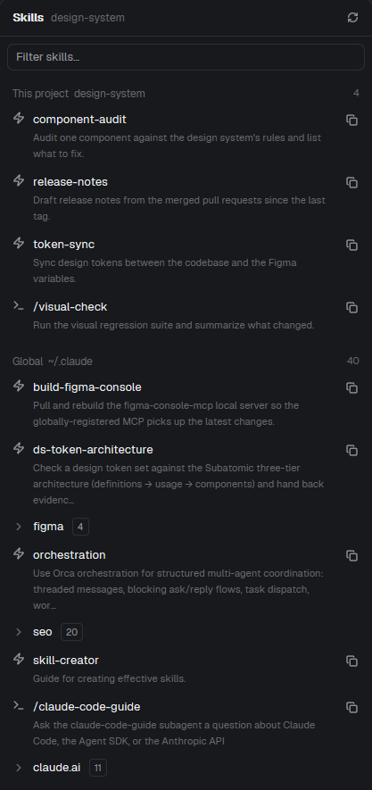

# Skills panel for Herdr

A side panel for the [Herdr](https://herdr.dev) desktop app that lists the Claude Code skills and slash commands available where you are working: the project's first, then your global ones. Click one to read it.



## What it adds

- **This project**: the skills and commands in the `.claude` folder of the focused terminal's project.
- **Global**: the ones in `~/.claude`, including the skills synced from claude.ai.
- **Families fold into one row.** Four or more names that start with the same word (`seo-audit`, `seo-content`, …), a command namespace (`team:deploy`), and the claude.ai skills each become one row with a count. Click to unfold.
- **Each row** shows the name and the first sentence of its description.
- **A filter box** narrows both lists by name or description.
- **Copy** puts `/name` on the clipboard, ready to paste into Claude Code.
- **Click a row** to read the whole skill, rendered as markdown.
- It follows you: focus a terminal in another project and the panel shows that one.

It is read-only. It never edits, runs or installs a skill.

## Requirements

Node.js on `PATH`. The panel says so when it is missing.

## Install

Ask your Herdr agent:

> Read ~/.config/herdr-app/AGENTS.md, then add this mod: https://github.com/cris-achiardi/herdr-mods/tree/main/skills

It follows [RECIPE.md](RECIPE.md). Installation has two parts:

1. Copy `mods/skills/` into `~/.config/herdr-app/mods/`.
2. **Give it a place and a button.** `mod.json` uses `"place": "none"`, so copying the folder alone shows nothing. Add a `skills` block to your layout's `panel-body` stack and a Skills button to your tab bar mod. RECIPE.md has both edits.

Herdr's shipped layouts and mods are read-only and restored on every start, so on a stock setup step 2 means cloning the `main` layout and the `tabs` mod and editing the clones.

### Without touching the layout

```sh
herdr-app do pane.split '{"direction":"right","mod":"skills"}'
```

Props: `cwd` pins the pane to one folder; `open` (a name) starts on that skill; `filter` starts filtered.

## What it runs

- `node mods/skills/scan.cjs <folder>` when the panel is shown and the focused folder changes, on refresh, and once a minute. It reads the first 16 KB of each `SKILL.md` and command file under `.claude/skills` and `.claude/commands`, in the focused folder, its parents (below the home folder) and `~/.claude`.
- The file of the skill you open, to draw it.
- The clipboard, when you click Copy.

No network access. It writes nothing.

## Limits

- Skills that come with plugins are not listed, and neither are subagents.
- A project on another machine is not read; only the global list shows.
- It lists what is on disk. It does not know whether Claude Code has a skill disabled, and for skills synced from claude.ai it assumes the `/anthropic-skills:<name>` form.
- Skills in subfolders of the project are not found, only those of the focused folder and its parents.
- Built and used on Windows with Herdr 0.1.15 and Claude Code 2.1. macOS and Linux are untested.

## License

MIT, see [LICENSE](../LICENSE). Icons are drawn after [Lucide](https://lucide.dev) (ISC, see `mods/skills/LICENSE-lucide.txt`).
