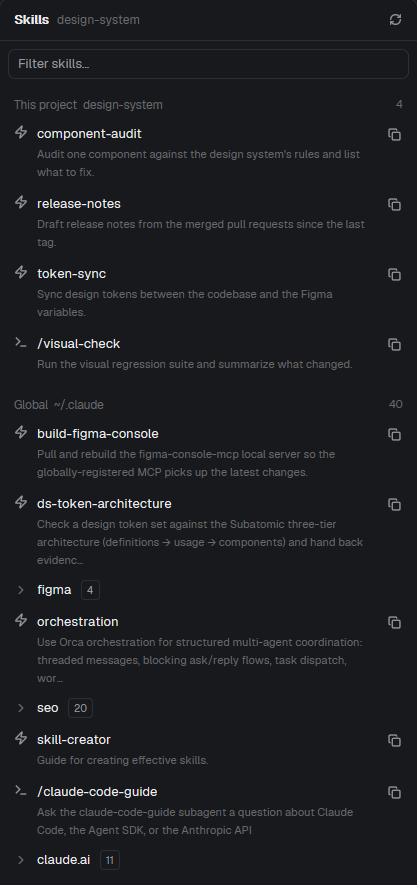

# Skills

A side panel that lists the Claude Code skills and slash commands that apply where the focused terminal is: the project's, then the person's global ones. A row opens that skill's text in the same panel. It sits in the right panel beside Files, Changes and Git, opened from a Skills button in the tab bar. It is read-only.



## What you see

A card that fills its block: `background`, 1px `border`, radius 10, text 13px in `foreground`.

**Header**, 42px, 14px left padding, 9px right, 1px `border` below: "Skills" semibold; the project folder's name in 12px `dim`, truncated, taking the remaining width; a 24px refresh button (13px icon in `muted`, radius 6, `hover` background and `foreground` icon on hover) whose icon spins (one turn per 900 ms) while scanning.

**Filter**, under the header with 8px side and top padding: a 30px input, radius 7, 1px `border`, 12.5px text, placeholder "Filter skills…".

**List**, scrolling, 6px padding, two sections, "This project" then "Global", 8px apart.

- Section heading, 30px, 8px side padding, 11.5px `dim`: the title in medium weight; a note (the project folder's name; `~/.claude`), truncated; at the right the count in 10.5px, or `3 of 40` while filtering.
- Row: 8px left and 4px right padding, 6px vertical, 9px gaps, radius 7, `hover` on hover, top-aligned. A 14px icon in `muted` (a bolt for a skill, a prompt for a command); the name on one line, truncated (a command's with its slash); under it the description's first sentence, at most 130 characters, wrapping, 11px `dim`; a 24px copy button, which shows a check for 1.5 s after copying.
- Family row, 30px: a 14px chevron in `dim` (right when folded, down when open), the family's name, and its count in a 10px `muted` badge with a 1px `border`. Its rows follow when open, indented to 26px. Families start folded.
- An empty section reads "No skills or commands in this folder's .claude." / "No skills or commands in ~/.claude.", "Projects on other machines aren't read." for a remote space, or "No match" while filtering.

**Detail**, in place of the filter and list. The header becomes: a back arrow, `/name` semibold (at most 220px), "skill" or "command" in `dim`, copy, refresh. Below, scrolling, 14px padding, 10px gaps: the full description in 12.5px `muted`; for an item with an `argument-hint`, `/name hint` in the terminal font; the file's path in 11px `dim` terminal font with the home folder as `~`, truncated, full path in a tooltip; a 1px `border` rule; the file's text after its frontmatter as markdown ("Loading…" until read, "Nothing but its description." when empty).

**Problems** replace the filter and list with a semibold title and one `muted` sentence: "Node.js not found", or "Couldn't list skills" with the first line of the error.

## How it behaves

- Agent statuses (working, blocked, done, idle) are not shown. Only the refresh icon animates.
- The folder is the focused pane's live folder (else the focused terminal's, else the active space's), as the shipped `changes` mod finds it. Focusing a terminal elsewhere rescans within 3 s.
- It rescans when shown data is older than a minute, checked every 3 s, and on refresh. While its layout block is hidden, or is not the shown child of its stack, it runs nothing.
- Project items are those of the folder and of each parent folder below the home folder, nearest first; a name found nearer hides the same name further up.
- Families, within a section: every item scan marks with a family (the claude.ai skills); names sharing a namespace before `:` when there are two or more; names sharing the word before the first `-` when there are four or more (the bare word itself included: `seo` with `seo-audit`). Order is the scan's: skills by name, then commands, then claude.ai; a family sits where its first member would.
- Typing in the filter shows matching rows flat, without families: an item matches when its name or description contains the text, ignoring case.
- Clicking a family folds or unfolds it; unfolded families are kept in `localStorage`.
- Clicking a row opens its detail; the back arrow returns to the list with the filter kept.
- Copy puts `/` and the item's run name on the clipboard: the name, or `anthropic-skills:<name>` for a claude.ai skill.
- Nothing is written anywhere.

## Built from

- `mods/skills/`: `main.js`, `scan.cjs`, `mod.json` `{ "place": "none" }`, icons `skill`, `command`, `copy`, `check`, `back`, `refresh`, `chevron-down`, `chevron-right` (drawn after Lucide) and `LICENSE-lucide.txt`.
- `main.js`: one `View`. `herdr` functions: `spaces`, `panes`, `focused`, `exec`, `theme`, `layout`, `settings`, `props`, `appHome`, `readTextFile`. `gpui-base`: `v_flex`, `h_flex`, `InputState` + `Input`, `TextView.markdown(id, text).selectable(true)`. `cx.write_to_clipboard`, `cx.timer.every`, `cx.timer.after`. No app commands. Props, all optional: `cwd` (scan this folder whatever is focused), `open` (a name: start on that item), `filter` (start filtered), `unfolded` (family ids such as `"global:seo"`, instead of the remembered ones).
- `scan.cjs` (CommonJS, Node 18+, no dependencies), run as `node <appHome>/mods/skills/scan.cjs [folder]` with a 20 s timeout, prints `{ home, project: { root, name, items } | null, global: { items } }`. An item: `{ kind: "skill" | "command", name, run, description, hint, path, family }`.
  - Skills: `<base>/skills/<dir>/SKILL.md`; name from the frontmatter's `name`, else the folder.
  - Commands: `<base>/commands/**/*.md`; name from the path, folders joined with `:`.
  - Bases: `<dir>/.claude` for the folder and each parent, stopping before the home folder; `~/.claude`; and for skills only `~/.claude/skills/synced/<id>/`, with `family: "claude.ai"` and `run: "anthropic-skills:<name>"`.
  - Only the first 16 KB of a file is read. Frontmatter: top-level `key: value` lines, quoted values, `>` and `|` blocks, and plain values continued on indented lines; whitespace collapsed. Without a `description`, the first non-empty line of the body.
  - `project` is null when no base under the folder has items; its `root` is the nearest folder that has.

**Wiring it into the window.** Shipped layouts and mods are read-only and restored on every start: if the person's layout or tab bar is shipped, clone them (`layout.clone`, `mod.clone`), point the cloned layout's `tabs` block at the cloned tab bar, and edit the clones. If the person already has their own, ask whether to change it or make a new one.

- Layout: in the `panel-body` stack of the `main` layout (0.1.15), add a child:

  ```json
  { "id": "skills", "type": "block", "content": { "mod": "skills" } }
  ```

- Tab bar (the `tabs` mod, 0.1.15): add `"skills"` to `enabled` and one button after the others:

  ```js
  .child(panelButton("skills", "Skills", "mods/skills/skill.svg"))
  ```

- No layout change at all: `herdr-app do pane.split '{"direction":"right","mod":"skills"}'` opens it as a pane.

## Watch out

- Copying the folder alone shows nothing. The install is not done until the person can open the panel from their tab bar, or chose the pane instead.
- A mod can read a file but cannot list a folder, hence `scan.cjs`. It must keep the `.cjs` extension: Herdr reads `.js` in a mod folder as a module.
- Descriptions are often one very long quoted line, or a `>` block. Read them whole in the scan and shorten only when drawing a row.
- `~/.claude/skills/synced` is a container of account folders, not a skill; don't list it as one.
- Stop the walk up before the home folder, or `~/.claude` is listed twice.
- A skill and a command can share a name (`figma-explain`): ids of rows and of `TextView.markdown` must include the kind or the path.
- `.when(cond, …)` needs a real boolean.
- The block is found by `content.mod === "skills"`: a renamed copy must update that constant and the scan's path.
- `herdr-app check` renders the first frame only (loading). To see a list: `herdr-app do pane.split '{"direction":"right","mod":"skills","props":{"cwd":"<a project folder>"}}'`.
- Built and used on Windows with Herdr 0.1.15 and Claude Code 2.1.325. Untested on macOS, Linux and remote machines.

## Done when

- `herdr-app check` passes for `mods/skills` and for the tab bar mod that was edited; `herdr-app status` shows no errors.
- The tab bar has a Skills button; clicking it shows the panel, clicking it again hides it.
- In a project with `.claude/skills`, "This project" lists them with the same names as the folders' `SKILL.md` files; "Global" lists those of `~/.claude`.
- Four or more names with one first word show as one folded row with their count; clicking it shows them, and it stays open after a restart.
- Typing in the filter narrows both sections and shows `n of total`.
- Clicking a row shows the skill's text; the back arrow returns to the list. Copy puts `/name` on the clipboard.
- Focusing a terminal in another project changes "This project" within a few seconds.
