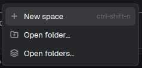

# Space Menu for Herdr

A right-click menu for the Spaces list in the [Herdr](https://herdr.dev) desktop app that opens folders the way an editor does: pick a folder and a space starts there, instead of making an empty space and `cd`-ing to where you wanted to be.



## What it adds

- **New space**: Herdr's own command, unchanged.
- **Open folder…**: the system folder picker, then a new space in the chosen folder. The space is named after the folder (or its repository), as Herdr names any unnamed space.
- **Open folders…**: a dialog that collects several folders, then makes **one space with a tab per folder**, each tab named after its folder. Optionally the first tab starts Claude Code with the other folders passed as `--add-dir`.
- On a space's row, the menu also carries Herdr's own space items (Rename, New/Open/Remove worktree, Close), so it replaces the shipped space menu without losing anything.
- **Other machines.** For each machine added with `hc machine add`, a section headed with its name: **New space**, **Open folder…** and **Open folders…** on that machine. The system picker only shows this computer's folders, so these open a folder browser that lists the machine's folders over the connection, with its git repositories (and the folders its spaces use) under **Projects** at the top. Type part of a name to filter, or a path and Enter to go there. While a machine is offline its section is greyed out.

The top **New space** follows the focused space's machine, as Herdr's **+** does. The top **Open folder…** and **Open folders…** always make the space on this computer, since that's whose folders the picker shows.

## Install

Ask your Herdr agent:

> Read ~/.config/herdr-app/AGENTS.md, then add this mod: https://github.com/cris-achiardi/herdr-mods/tree/main/space-menu

It follows [RECIPE.md](RECIPE.md). Installation has two parts, and the second is the one that matters:

1. Copy `mods/space-menu/` into `~/.config/herdr-app/mods/`.
2. **Point your Spaces sidebar's right-click at it.** `mod.json` uses `"place": "none"`, and a sidebar opens Herdr's shipped `menu` mod on right-click, so copying the folder alone changes nothing. The sidebar mod has to open `space-menu` instead. RECIPE.md has the exact edit for Herdr's stock `spaces` mod and for [Better Sidebar](https://github.com/munza/herdr-mods/tree/main/better-sidebar).

Herdr's shipped mods and layouts are read-only and restored on every start, so on a stock setup step 2 means cloning the `spaces` mod and your layout and editing the clones. Clones are yours and stop receiving Herdr's updates to those files.

### Without touching the sidebar

`mod.json` declares the menu as a popup, so a key can open it with no sidebar change. In `~/.config/herdr-app/keys.json`, under `global`:

```json
"<your key>": "mod.open:space-menu"
```

Opened this way it shows New space, Open folder… and Open folders…, without the per-space items.

## What it runs

- The system folder picker (`pickFolder`), on this computer only.
- On another machine, through Herdr (`exec` with `on`), only while one of its dialogs is open: `uname` and `pwd` to learn its system and home folder (on Windows, PowerShell's `$HOME`), `find` or PowerShell `Get-ChildItem` to list a folder's folders, and the same to find git repositories up to four folders below home (skipping hidden folders, links, `node_modules`, `~/Library` and `AppData`). It changes nothing there.
- `git rev-parse` in a right-clicked space's folder, to decide whether to offer the worktree items.
- Herdr's installed-agent check (`knownAgents`), to decide whether to offer the Claude Code option.
- App commands: `space.new`, `space.rename`, `space.close`, `tab.new`, `tab.rename`, `tab.select`.

No network access. It reads no files and writes nothing outside Herdr's own state.

## Limits

- **A multi-folder space is not a sandbox.** A Herdr space is a starting point, not a fence: any terminal in it can `cd` anywhere. `--add-dir` sets which folders Claude Code works in; it does not restrict the shell.
- The folder picker returns one folder at a time, so Open folders… adds them one by one.
- Another machine's folders are browsed in Herdr's own dialog, not a system picker: no favorites, no search beyond the folder you're in and the Projects list.
- The Claude Code option appears only when Herdr reports Claude Code as installed. Other agents are not offered.
- Built on Windows with Herdr 0.1.15; the other-machines part on macOS with hc 0.1.22, browsing a Windows PC and a macOS machine. Linux is untested.

## License

MIT, see [LICENSE](../LICENSE). The per-space items and the menu's look follow Herdr's shipped `menu` mod; icons are referenced from Herdr's shipped `workspace-chrome` mod, not copied.
