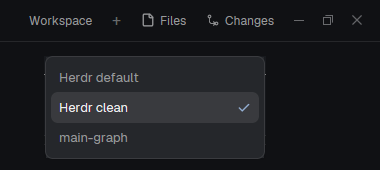

# Workspaces

A "Workspace" link in the tab bar that opens a small menu of your layouts, like the workspace menu in Adobe apps. Each layout places its own set of mods, so picking a layout switches which mods are on screen: one for design work, one for a workshop, Herdr's own default.

## What it does

- **Workspace** sits in the tab bar just before the `+` button, as plain text, apart from the panel buttons.
- Clicking it opens a menu at the pointer listing every layout in `~/.config/herdr-app/layouts/`, the shown one ticked. Herdr's demo layouts (Terminals, Herdr 98) are left out. `main` reads "Herdr default"; `clean` reads "Herdr clean".
- Click a row, or use ↑/↓ and Enter, to switch. Esc closes it.
- Nothing is uninstalled or reinstalled: mods a layout doesn't place simply aren't shown.

**Herdr clean.** Herdr's own layout and tab bar are read-only, so the link can't be added to them. The recipe makes `clean`, a copy of Herdr's default layout whose tab bar (`tabs-workspace`, a copy of Herdr's `tabs`) has the link. It looks like Herdr's default plus that one link, so you can show stock Herdr and still switch back with a click.

## Install

Ask your Herdr agent:

> Read ~/.config/herdr-app/AGENTS.md, then add this mod: https://github.com/cris-achiardi/herdr-mods/tree/main/workspaces

It follows [RECIPE.md](RECIPE.md). Installation has two parts:

1. Copy `mods/workspaces/` into `~/.config/herdr-app/mods/`.
2. Add the Workspace link to the tab bar of each layout that should have it, and optionally make the `clean` layout.

## What it runs

- `layouts()`, `shared("layout")` and the app command `layout.switch {name}`. No programs, no network.

## Limits

- Herdr's shipped `main` layout has no link. From it, switch back with **Ctrl+Shift+L** (next layout) or `herdr-app do layout.switch '{"name":"<layout>"}'`.
- The hidden names (`terminals`, `win98`) are fixed in `main.js` and repeated in the tab bar's height calculation.
- A layout switch closes open overlay windows.
- Built and used on Windows with Herdr 0.1.15. Untested on macOS and Linux.
