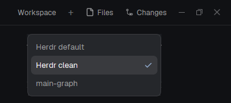

# Workspaces

A layout picker: a "Workspace" text link in the tab bar opens a popup listing the layouts in `layouts/`, the shown one ticked; choosing one runs `layout.switch`. Since each layout places its own mods, this is how a person switches sets of mods.



## What you see

**The link**: in the tab bar, after the scrolling tab strip and immediately before the `+` (new tab) button. Plain text "Workspace", no icon: 26px high, 8px side padding, radius 6, text 12px in `muted`; on hover `hover` background and `foreground` text.

**The menu**: a popup at the pointer, 220px wide, on `popover`, 5px padding, text 12.8px. One 31px row per layout (8px side padding, radius 7): the label, truncated, in `foreground` for the shown layout and `muted` for the others; the shown layout also gets a 14px `accent` check (`mods/workspace-chrome/check.svg`) at the right. The highlighted row is `selected`, hovered rows `hover`. With no layouts to list, one `dim` row reads "No layouts".

Rows are `layouts()` in its order (main first), minus `terminals` and `win98` (Herdr's demo layouts). Labels: `main` → "Herdr default", `clean` → "Herdr clean", any other layout by its file name.

## How it behaves

- The highlight starts on the shown layout (`shared("layout")`). ↑/↓ move it (wrapping), Enter chooses, Esc closes. A click chooses.
- Choosing closes the popup, then runs `layout.switch {name}` unless that layout is already shown.
- Nothing animates. Agent statuses are not shown.

## Built from

- `mods/workspaces/`: `main.js` and `mod.json` `{ "place": "none", "title": "Workspaces", "overlay": { "kind": "popup", "width": 220, "height": 103 } }`. Nothing docks by itself.
- `herdr` functions: `run`, `props`, `closeOverlay`, `theme`, `layouts`, `shared`. `gpui-base`: `v_flex`, `h_flex`. Command: `layout.switch`.
- Opened by the tab bar, not by this mod. A mod can't import another mod's code, so the opener sizes the popup itself: `height = 10 + 31 * max(1, rows)`.

**Wiring the link.** Shipped mods and layouts are read-only and restored on every start. If the person's layout or tab bar mod is shipped, clone it (`mod.clone`, `layout.clone`), point the clone layout's tab bar block at the cloned mod, and edit the clone. If they already have their own, ask which layouts get the link.

In a tab bar mod based on Herdr's `tabs` (0.1.15), import `layouts` from `"herdr"` and insert before the `tab-new` button:

```js
// Workspace: the workspaces mod's layout picker, sized to its rows (31px each, 5px padding).
.child(h_flex().id("workspace").h(26).px(8).flex_none().items_center().rounded(6).text_size(12).text_color(t.muted)
  .hover(s => s.bg(t.hover).text_color(t.foreground)).on_mouse_down("left", stop)
  .on_click(() => openOverlay({ mod: "workspaces", kind: "popup", width: 220,
    height: 10 + 31 * Math.max(1, layouts().filter(n => n !== "terminals" && n !== "win98").length) }))
  .child("Workspace"))
```

(`stop` is the tab bar's existing `(_e, cx) => cx.stop_propagation()`; it keeps the press from dragging the window.)

**Herdr clean** (offer it; the person decides). A copy of Herdr's default with the link:

```sh
herdr-app do mod.clone '{"name":"tabs","as":"tabs-workspace"}'
herdr-app do layout.clone '{"name":"main","as":"clean"}'   # switches to it
```

Add the link to `mods/tabs-workspace/main.js` as above, then in `layouts/clean.json` change the tab bar block's `"mod": "tabs"` to `"mod": "tabs-workspace"`. Switch back to the person's layout when done.

## Watch out

- Copying the folder alone shows nothing. The install is not done until clicking Workspace in the person's tab bar opens the menu.
- Herdr's shipped `main` can't carry the link; from it, Ctrl+Shift+L (`layout.switch` with no name) steps to the next layout.
- The hidden names live in two places, this mod and the opener's height; change both together.
- `layout.clone` switches the window to the clone. Put the person back on their layout afterwards.
- `herdr-app check` loads the mod with no props; it passes with or without a tab bar wired. To see the menu without the link: `herdr-app do mod.open '{"name":"workspaces"}'`.
- Built and used on Windows with Herdr 0.1.15. Untested on macOS and Linux.

## Done when

- `herdr-app check` passes for `mods/workspaces` and for each tab bar mod that was edited; `herdr-app status` shows no errors.
- Clicking Workspace opens the menu listing the person's layouts without Terminals and Herdr 98, the shown one ticked.
- Choosing another layout switches the window to it; `herdr-app status` reports that layout.
- If `clean` was made, it looks like Herdr's default plus the Workspace link, and the link switches back.
